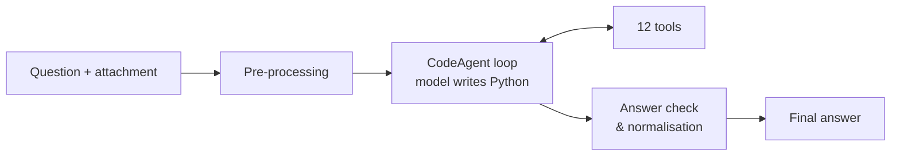

# Gala Agent

**English** | [中文](README.zh-CN.md)

The final project of the [Hugging Face Agents Course, Unit 4](https://huggingface.co/learn/agents-course/unit4/introduction): build an agent that answers 20 questions from the [GAIA](https://huggingface.co/gaia-benchmark) benchmark. Each question requires real work: multi-hop web research, reading Wikipedia tables, analysing Excel or Python attachments, transcribing audio, watching YouTube videos, or solving a chess position from an image. Answers are graded by exact match.

**Result:** `<SCORE>` / 20  
**Stack:** smolagents · DeepSeek `deepseek-flash` for text and vision · faster-whisper · Stockfish · yt-dlp · OpenCV · Gradio

---

## 1. Agent design

**Framework.** The agent is a smolagents `CodeAgent`. Instead of emitting JSON tool calls, the model writes Python at every step. One step can call several tools, loop over results and compute with pandas, which suits GAIA's multi-hop questions.



**Three design principles**

1. **Give the model everything at step 1.** Before the loop starts, attachments are pre-processed: audio is transcribed, images are attached, code and spreadsheets are previewed, and file paths are injected.
2. **Deterministic work belongs to code.** Transcription, spreadsheet maths, running attached code and chess search are done by tools and libraries, never "in the model's head".
3. **The model decides and synthesises.** Its job is to choose the next action and combine evidence into an answer.

## 2. Tool design

| Area | Tools | Key design point |
|---|---|---|
| Web | `web_search`, `visit_webpage` | Pages converted to Markdown with tables kept; PDFs supported; long pages paginated |
| Wikipedia | `wikipedia_search`, `wikipedia_page` | Full article with tables; can read the version from a given date |
| Files | `read_file`, `run_python_file` | All Excel sheets and rows; attached code is actually executed |
| Audio | `transcribe_audio` | Local Whisper, isolated in a child process |
| Vision | `analyze_image`, `analyze_youtube_video` | Video frames sampled and sent to the vision model in one request |
| Video text | `youtube_transcript` | Captions with timestamps |
| Chess | `chess_image_to_fen`, `chess_best_move` | Board split into 64 squares, voted over 3 passes, then Stockfish |

**Principles for writing tools**

- **Return text the model can read.** Markdown tables, timestamps and page markers instead of raw HTML or JSON.
- **Fail with a next step.** Errors say what to try instead, so the agent changes approach rather than retrying.
- **Respect the framework's limits.** Output is paginated below the framework's print limit and slow tools fit within the execution timeout.
- **Isolate fragile dependencies.** Native libraries that can crash run in a subprocess, so one failure doesn't end the run.
- **Decompose hard perception.** Asking a vision model to describe a whole chessboard is unreliable. Classifying one square at a time and voting is reliable.

## 3. Problems and solutions

Every fix came from reading the execution trace of a failed task.

| Problem seen in traces | Cause | Solution |
|---|---|---|
| Repeated Wikipedia calls returned the same intro paragraph | Tool used the summary endpoint | Fetch the full parsed article |
| Attachment questions answered by guessing | The agent was never told the file path | Inject path and content during pre-processing |
| Many answers were "Unable to determine" | The prompt asked the model to express uncertainty | Always answer with the best-supported result; reject non-answers |
| Parse errors: no `<code>` block found | DeepSeek sometimes uses its own tool-call format | Model wrapper rewrites it into a code block |
| Tools killed mid-run | Default 30-second limit per code block | Raise the executor timeout |
| Middle of long pages silently lost | Framework truncates printed output above 20k characters | Paginate tool output at 15k |
| Process exited without a traceback on Windows | Native crash inside the audio stack | Run transcription in a child process |
| Every model call failed after enabling a proxy | The proxy also captured LLM traffic | Route only YouTube through the proxy |
| Chess board read inconsistently | Whole-board description is hard for vision models | Per-square classification with voting, Stockfish for the move |
| Agent kept verifying a correct engine result until it ran out of steps | Over-verification | Tool states the result is authoritative; prompt rule against re-verifying; answer rescue as fallback |

## 4. Evaluating the agent's output

- **Exact-match scoring locally.** `run_local.py --score` applies GAIA's normalisation rules: numbers, lists and strings are each compared differently.
- **A trace for every task.** Each run writes the full step-by-step log. Failures are classified as tool, framework or prompt problems and fixed in that order of impact.
- **Guard the final answer.** Non-answers, code and long explanations are rejected and the agent keeps working. Formatting is normalised. If the step budget runs out, a final answer is extracted from the evidence already collected.
- **Audit the evidence.** For every answer, check in the trace where it first appeared. A correct answer must come from a primary source, not from somewhere that already contains it.

## 5. When the agent cheats

The evidence audit showed that some correct answers came from the wrong places:

- mirrors of the benchmark on Hugging Face and GitHub;
- other agents' published run logs;
- SEO pages generated from people's search queries;
- in one trace, the agent itself searching for the task ID plus "answer".

**Defences**

- `web_search` refuses queries that target the benchmark or a task ID.
- Results are dropped if they come from benchmark mirrors or run logs, or if they contain the question text verbatim.
- The prompt forbids looking up the benchmark.
- Affected tasks were re-run with the filter on and solved from primary sources: the video itself, Wikipedia's featured-article log, the original textbook page.
- The answer cache is not published, so this repo cannot become a leak source either.

## 6. What I learned about agents

- **An agent is more than a prompt.** It is model + tools + loop + the engineering around them. Most of the gains came from tools and the harness, not from prompt wording.
- **The bottleneck is information, not intelligence.** When the model could not read a table, no instruction could help.
- **Read traces before changing anything.** Every real fix here came from a trace, not from a guess.
- **Frameworks fail silently.** Timeouts, truncation and format mismatches don't raise errors. They just burn steps.
- **A high score needs an audit.** Agents with web access will find the answer key if it exists. Evaluation has to check where answers come from.
- **Fast feedback beats clever tricks.** Single-task runs, cached answers and per-task logs turned hours of guessing into minutes per iteration.

---

## Project structure

```
app.py          Gradio UI: log in and submit cached answers
run_local.py    Dev loop: single-task runs, answer cache, logs, local scoring
agent.py        Pre-processing, CodeAgent loop, answer checks
tools.py        12 tools and the leakage filter
prompt.py       Agent instructions
```

## Quick start

```bash
pip install -r requirements.txt
cp .env.example .env           # add DEEPSEEK_API_KEY
python run_local.py --task <id>
python run_local.py --list
python app.py
```

Optional: put Stockfish under `stockfish/`. Set `HTTPS_PROXY` if YouTube is blocked on your network.
