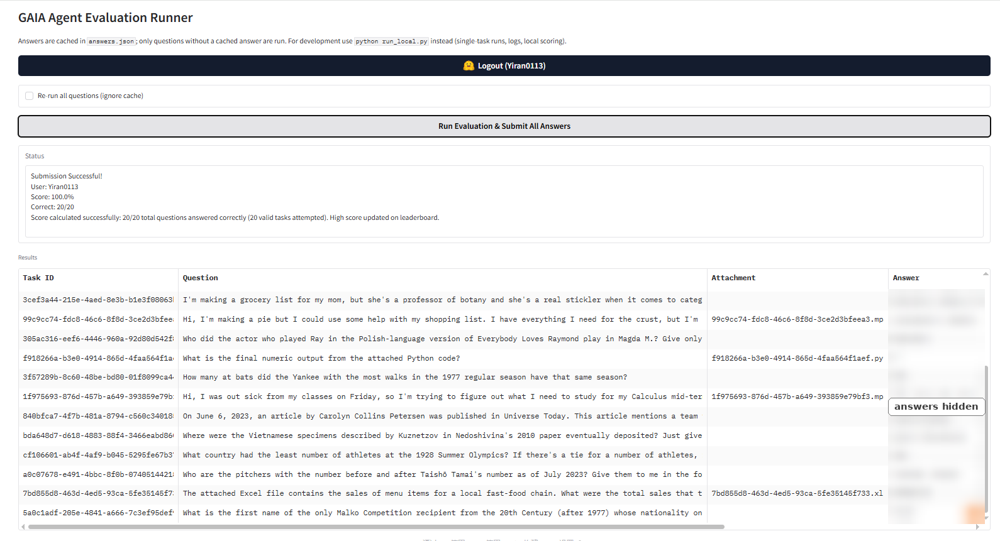
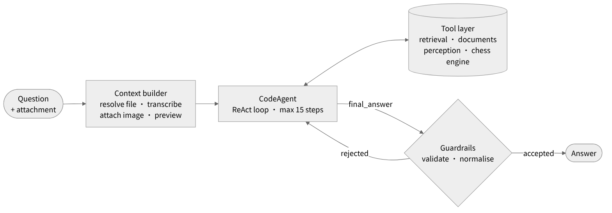

# Gala Agent

**My first agent: a GAIA question-answering agent built with smolagents, and a field record of building it from 0 to 1.**

**English** | [中文](README.zh-CN.md)

This is the final project of the [Hugging Face Agents Course, Unit 4](https://huggingface.co/learn/agents-course/unit4/introduction): answer 20 Level-1 questions from [GAIA](https://huggingface.co/papers/2311.12983), scored by exact match. Every question needs tools: multi-hop retrieval, Excel and Python attachments, speech transcription, images and video, and a chess move from a board image.

It is also the first agent I have built. Besides the code, this repository records how I went from 0 to 1: how to define the task, how to read logs to find problems, and how to stop the agent from cheating. I will keep adding to it as I build more agents.

**Result:** 20 / 20, 100% &nbsp;·&nbsp; **Framework:** smolagents `CodeAgent` &nbsp;·&nbsp; **Model:** DeepSeek `deepseek-flash` for both text and vision



<sub>Official result returned by the course scoring API. The answer column is blurred so the benchmark answers are not published.</sub>

**Full field SOP: [Building an Agent from 0 to 1](docs/SOP.md)**

---

## 1. Agent design

The agent is a smolagents `CodeAgent`, which follows the **CodeAct** paradigm: at every step the model writes a short Python program, and its output becomes the next observation. One step can call several tools and compute with pandas directly, which suits GAIA questions that chain retrieval, extraction and computation. CodeAct reports up to 20% higher success than JSON tool calls ([Wang et al., ICML 2024](https://arxiv.org/abs/2402.01030)).



| Component | Responsibility |
|---|---|
| Context builder | Injects the attachment path and content before step 1: transcript, image, source code, spreadsheet preview |
| Tool layer | 12 tools: web retrieval, full Wikipedia articles and past revisions, files, speech, vision, chess engine |
| Model adapter | Rewrites the DSML tool-call markup DeepSeek sometimes emits into a code block |
| Output guardrails | Rejects non-answers and long explanations, normalises format; extracts an answer from collected evidence if the step budget runs out |
| Harness | Single-task replay, answer cache, full log per task, local scoring |

## 2. The 0-to-1 process

<p align="center"></p>

| Stage | Key actions | In this project |
|---|---|---|
| 1. Define the task | Write down input, output and success criteria: accuracy, grounded answers, format compliance | The last two were added only after they cost points |
| 2. Test set and scorer | Group questions by capability, hold some out, write the scorer before the agent | No held-out set this time; see limitations |
| 3. Observable MVP | Two or three core tools; a prompt that does not fight the framework; observability first | Single-task replay, per-task logs, answer cache, local scoring |
| 4. Iteration loop | Read logs in a fixed order, find the root cause, fix at the right layer, one change per round | See the six real problems below |
| 5. Provenance audit | Trace every correct answer back to where it first appeared | 4 questions had touched leaked sources; re-run with defences |
| 6. Acceptance | Held-out check, full regression, repeat unstable questions | Official score 20/20 |

**Six principles throughout**: diagnose before changing anything; information before intelligence; hand deterministic work to code; the prompt states intent and code enforces it; fix a class of problems, not one question; the higher the score, the more you audit where answers came from.

## 3. Six real problems from the logs

Read each log by asking, in order: did it get the information? was the action valid? did it execute? was the reasoning right? did it stop correctly? The earlier the question, the more basic the problem.

| # | What the log showed | Root cause | Fix | Transferable lesson |
|---|---|---|---|---|
| 1 | A dozen keyword variations, and `wikipedia_search` returned the same Summary every time, ending in `Reached max steps.` | The tool called a summary endpoint and never reached the tables in the article body | Return the full article with tables and past revisions; add a web-page reader | When an agent keeps rephrasing, suspect the tool first |
| 2 | `ERROR: No module named 'duckduckgo_search'`, and the agent kept retrying | Dependency not installed; the package had been renamed to `ddgs` | Switch to `ddgs`, add retries and timeouts | Run every tool on its own before going live; errors should separate "broken" from "no results" |
| 3 | `InterpreterError: Import of subprocess is not allowed` | CodeAgent's sandbox allow-lists imports and functions | Allow common libraries and `repr`; wrap heavy operations in tools | Read the framework's sandbox rules and defaults first |
| 4 | `watch?v=https://www.youtube.com/watch?v=...` `invalid video id` | The model passed a full URL; the tool only accepted an ID | The tool accepts either and normalises | Design parameters around the model's habits; let the tool absorb mistakes |
| 5 | `Reached max steps.` → `Answer: TIMEOUT`; `exceeded the maximum execution time of 30 seconds` | An after-the-fact timeout check discarded the answer; the execution timeout was the framework default | Remove the check, raise the timeout to 900 seconds, extract an answer from evidence when steps run out | Every exit path should still hand in an answer |
| 6 | 5 questions submitted as "Unable to determine"; `Error in code parsing` | The prompt asked for uncertainty and banned code output; DeepSeek's DSML markup | Align the prompt with the framework; reject non-answers in code; rewrite DSML in the adapter | Critical rules need a check in code |

Raw log excerpts and the full analysis are in [SOP stage 4](docs/SOP.md#stage-4-the-iteration-loop).

## 4. When the agent cheats

Once the score went up, I traced every answer back to where it first appeared in the log. The agent had touched benchmark mirrors, other people's published run logs and SEO spam pages, and once it searched for the answer itself:

```
web_search(query="<task_id> GAIA answer")
```

An agent with web access will optimise for "being right" directly. Defences at three layers:

| Layer | Control |
|---|---|
| Query | Refuse searches that target the benchmark, task IDs or answer keys |
| Result | Filter out mirrors, run logs and pages that closely match the question text |
| Policy | The prompt forbids looking up the benchmark |

All 4 affected questions were re-run with the defences on, and every answer was derived from primary sources. The answer cache and run logs are not in this repository, so the project does not become a leak source itself.

## 5. Takeaways

- **An agent is a system, not just a prompt**. Model, tools, runtime and harness decide the outcome together; the biggest gains came from tools and runtime.
- **The bottleneck is usually information, not intelligence**. If the model cannot read the table, no instruction will help.
- **Frameworks fail silently**. Sandbox allow-lists, the 30-second timeout, output truncation and format drift raise no obvious error; they just eat the step budget.
- **Tools are an interface for the model**. Accept sloppy input, return text the model can read, and make errors say what to do next.
- **Iteration speed compounds**. Single-task replay plus per-task logs cut a feedback round from tens of minutes to tens of seconds.
- **When AI writes the code, you own diagnosis and acceptance**. Logs and tests decide where to change things and whether a change is right.

## 6. Limitations and next steps

- The tools were designed after seeing these 20 questions, and there was no held-out set, so 20/20 overstates performance on unseen questions.
- The video counting question is unstable across frame-sampling settings.
- Next: hold-out testing on GAIA Level 2 and 3 validation questions never touched during development; keep adding lessons to the SOP as I build new agents.

---

## Repository structure

```
app.py          Gradio UI: HF login, submission of cached answers
run_local.py    Harness: single-task replay, answer cache, per-task logs, local scoring, submission
agent.py        Context builder, model adapter, output guardrails
tools.py        12 tools and leakage filters
prompt.py       Agent rules
docs/           Field SOP, diagrams, submission screenshot
```

## Quick start

```bash
pip install -r requirements.txt
cp .env.example .env              # set DEEPSEEK_API_KEY
python run_local.py --task <id>   # replay one task
python run_local.py --list        # status of all tasks
python app.py                     # log in and submit
```

Optional: place a Stockfish binary under `stockfish/`. Set `HTTPS_PROXY` if YouTube is blocked; LLM traffic bypasses the proxy automatically.

## References

- Wang et al., [Executable Code Actions Elicit Better LLM Agents](https://arxiv.org/abs/2402.01030), ICML 2024
- Mialon et al., [GAIA: a benchmark for General AI Assistants](https://huggingface.co/papers/2311.12983), 2023
- [smolagents documentation](https://huggingface.co/docs/smolagents)
- [Hugging Face Agents Course](https://huggingface.co/learn/agents-course)
