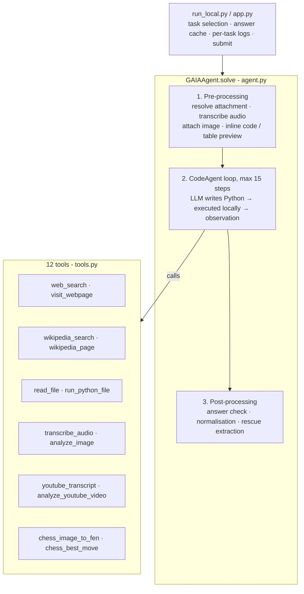

# GAIA Agent: a tool-using research agent for the GAIA benchmark

**English** | [中文](README.zh-CN.md)

A single-agent system built with [smolagents](https://github.com/huggingface/smolagents) and DeepSeek. It answers questions from the [GAIA](https://huggingface.co/gaia-benchmark) benchmark (Level 1 subset used in the Hugging Face Agents Course, Unit 4). Each question needs real research: multi-hop web lookups, reading Wikipedia tables, parsing Excel or Python attachments, transcribing audio, watching YouTube videos, or solving a chess position from an image. Answers are graded by exact match.

| | |
|---|---|
| **Result** | `<SCORE>` / 20 on the course's GAIA Level-1 evaluation set (see [Evaluation & limitations](#evaluation--limitations)) |
| **Stack** | Python · smolagents `CodeAgent` · DeepSeek API (`deepseek-flash`, text + vision) · faster-whisper · python-chess + Stockfish · yt-dlp + OpenCV · Gradio |
| **Cost** | No paid APIs beyond the LLM. Search, audio, chess and video all run free or locally |

---

## Architecture



The core design principle: **let code do everything that is deterministic, and let the model only decide what to do next and synthesise evidence.**

| Layer | Responsibility |
|---|---|
| **Pre-processing** (`build_task`) | Before the agent starts, the attachment is located and its content injected: audio is transcribed, images are attached, Python source and spreadsheet previews are inlined. The model has all inputs at step 1. |
| **Reasoning loop** | smolagents `CodeAgent`. Each step the model writes Python that calls tools or libraries (pandas, python-chess); the output becomes the next observation. |
| **Model adapter** | `DeepSeekModel` rewrites DeepSeek's native tool-call markup into the `<code>` blocks smolagents expects. |
| **Answer safety net** | `answer_check` rejects non-answers ("unable to determine", code, long text) and sends the agent back to work. `clean_answer` normalises format. `_rescue_answer` extracts a final answer from collected evidence if the step budget runs out. |
| **Dev loop** | `run_local.py`: run a single task, cache answers, write a full trace per task, run tasks in parallel, score locally, submit. |

### Tools

| Tool | Implementation |
|---|---|
| `web_search` | ddgs (DuckDuckGo / Bing / Brave), with retries and a **leakage filter** (see below) |
| `visit_webpage` | HTML → Markdown (tables preserved), PDF text extraction, paginated |
| `wikipedia_search` / `wikipedia_page` | MediaWiki API, full article incl. tables, `as_of_date` to read a historical revision |
| `read_file` | Excel (all sheets/rows), CSV, PDF, DOCX, PPTX, text |
| `run_python_file` | Executes attached code in a subprocess and returns stdout |
| `transcribe_audio` | Local faster-whisper, isolated in a child process |
| `analyze_image` | DeepSeek vision |
| `youtube_transcript` / `analyze_youtube_video` | Captions; or download with yt-dlp, sample frames with OpenCV, send to the vision model |
| `chess_image_to_fen` | Board cut into 64 squares, each classified by the vision model, 3-pass majority vote, orientation from coordinate labels |
| `chess_best_move` | Stockfish (falls back to a small built-in alpha-beta search) |

---

## Engineering challenges & how they were solved

The first version (v1) scored poorly. I stopped tuning the prompt and **read the execution trace of every failed task**. Almost none of the failures were "the model isn't smart enough". They were infrastructure problems, which I grouped into four classes.

### 1. The agent could not reach the information

| Symptom (from traces) | Root cause | Fix |
|---|---|---|
| A discography question: 6 Wikipedia calls all returned the same intro paragraph | Tool used the REST *summary* endpoint, top-1 hit only | `wikipedia_page` returns the full parsed article incl. tables, plus `as_of_date` for "use the 2022 version" questions |
| Research questions answered from search snippets or memory | No tool to open a page, although the prompt claimed browsing ability | `visit_webpage` (HTML/PDF → Markdown, paginated) |
| Every search failed | Search dependency missing / renamed | Switched to `ddgs` with retries and timeouts |
| 5 attachment questions were essentially guessed | Only images were handled; the agent was never told the file path | Pre-processing injects the absolute path plus content (transcript / source / preview) |
| Audio questions impossible | No audio tool | Local faster-whisper |

### 2. The framework was silently eating steps

These never raise a visible error. They show up only in traces.

| Symptom | Root cause | Fix |
|---|---|---|
| `regex pattern <code>(.*?)</code> was not found` | DeepSeek sometimes emits its native tool-call markup instead of a code block | Model subclass that rewrites it into a `<code>` block before parsing |
| `Code execution exceeded the maximum execution time of 30 seconds` | smolagents' default per-snippet timeout killed audio/video/chess tools mid-run | Raised the executor timeout to 900s |
| Long pages lost their middle part | smolagents truncates printed output above 20k chars *from the middle* | Tools paginate at 15k chars and tell the agent how to continue |
| Process exited with no traceback on Windows | Native crash in the faster-whisper / PyAV stack | Transcription runs in a child process with `faulthandler`; a crash fails one tool call, not the run |
| `SelectorSyntaxError` on every Wikipedia page | CSS-selector incompatibility in a bs4 dependency | Replaced selectors with plain `find_all` filters |
| `Connection error` on every LLM call after enabling a proxy for YouTube | Proxy also captured DeepSeek traffic | `NO_PROXY` for the LLM endpoint; only YouTube goes through the proxy |

### 3. The rules were forcing lost points

| v1 rule | Effect | Fix |
|---|---|---|
| "Never output Python code" | Contradicts how `CodeAgent` works (it acts *through* code blocks): parse errors, and one answer submitted as raw code | Removed; prompt now aligned with the framework |
| "Clearly indicate uncertainty" | 5 answers were "Unable to determine…", each a guaranteed zero | Always give the best-supported answer; non-answers are rejected by `answer_check` |
| No output-format rules | Verbose answers failed exact match | Explicit GAIA formatting rules + `clean_answer` |
| Post-hoc timeout | A computed answer was discarded and replaced with "TIMEOUT" | Removed; step budget and per-tool timeouts bound runtime instead |

### 4. Problems that needed a different decomposition

**Chess from an image.** The vision model described the whole board inconsistently (two passes disagreed on piece squares), and the LLM could not search moves. I split the task into pieces each component is good at:

1. Cut the board into 64 squares and classify each one separately. Single-square classification is much easier than spatial description.
2. Run 3 passes and take a majority vote per square. Flag disagreements.
3. Detect orientation (white or black at the bottom) from the coordinate labels and map the grid to FEN in code.
4. Hand the FEN to Stockfish.

Result: the FEN came out exactly right and the engine found the move at step 3.

**Over-verification.** With a correct engine answer in hand, the agent spent 12 more steps trying to "prove" a forced win and ended without a clean answer. Fixes: the tool output now states the result is authoritative; a prompt rule against re-verifying reliable results; and the rescue extractor as a last line of defence.

### 5. Data leakage: discovered and closed

After the score jumped, I audited every trace for *where* each answer first appeared. Four tasks had touched leaked sources:

- benchmark mirrors on Hugging Face and GitHub;
- other agents' published run logs;
- auto-generated SEO pages that echo people's search queries, which sometimes include answers;
- in one trace, the agent itself searching for "`<task_id>` GAIA answer".

Mitigation, in `tools.py`:

- `web_search` refuses queries that target the benchmark (its name, task-id patterns, "answer key").
- Results and pages are dropped if they come from benchmark datasets or trace dumps, or if they contain the question text verbatim, or if they are query-echo spam.
- The prompt forbids searching for the benchmark itself.

All four affected tasks were re-run with the filter on and solved from primary sources: the original video frames, Wikipedia's featured-article log, the textbook page itself, and botanical reasoning in code. The answer cache is not published in this repo for the same reason.

---

## Evaluation & limitations

I want this section to be read before the score.

- **Tuned on the test set.** The tools were designed after seeing these 20 questions (e.g. the chess pipeline, historical Wikipedia revisions). The score therefore **overstates performance on unseen tasks**.
- **Possible memorisation.** The questions are public; the LLM may have seen them during training. Every answer is backed by a tool trace, but a trace cannot prove the model did not "know first, then look".
- **Leakage audit** (above) found 4 contaminated tasks; all were re-solved cleanly. Remaining risk is model memory, not retrieval.
- **Vision counting is unstable.** On the video question, the species count varied between 2 and 3 across frame samplings. Denser sampling around key moments and per-frame structured output counted in code would be more robust.
- **Not yet tested on held-out data.** Next step: GAIA Level 2/3 validation tasks, untouched during development.

---

## Project structure

```
├── app.py            Gradio UI: HF login, submits cached answers
├── run_local.py      Dev loop: single-task runs, answer cache, per-task logs, local scoring, submit
├── agent.py          GAIAAgent: pre-processing, CodeAgent loop, answer check / cleaning / rescue
├── tools.py          12 tools + leakage filter
├── prompt.py         Instructions appended to the CodeAgent system prompt
├── requirements.txt
└── .env.example      DEEPSEEK_API_KEY, optional settings
```

Not committed: `.env`, answer cache, run logs, task attachments and question files (GAIA asks not to redistribute its data), Stockfish binary.

## Running it

```bash
pip install -r requirements.txt
cp .env.example .env            # add DEEPSEEK_API_KEY

python run_local.py --list          # status of all tasks
python run_local.py --task <id>     # run one task (task-id prefix)
python run_local.py                 # run every task without a cached answer
python app.py                       # Gradio UI → log in → submit
```

Optional: put a Stockfish binary under `stockfish/` (auto-detected) or set `STOCKFISH_PATH`. Set `HTTPS_PROXY` if YouTube is blocked on your network; LLM traffic bypasses it automatically.

## Acknowledgements

Built for the [Hugging Face Agents Course](https://huggingface.co/learn/agents-course), Unit 4. Developed with the help of AI coding assistants for code generation and review. Diagnosis, design decisions and verification are documented above.
