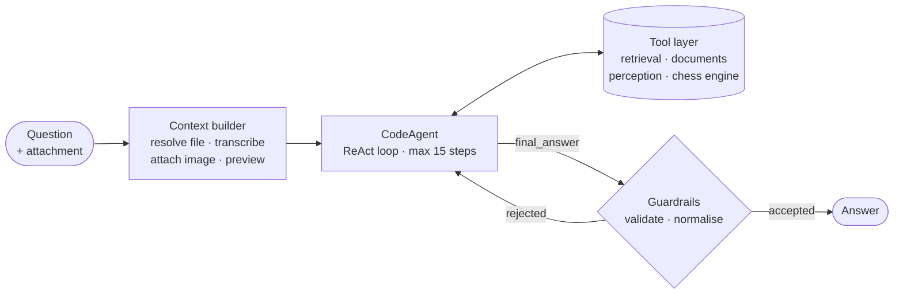
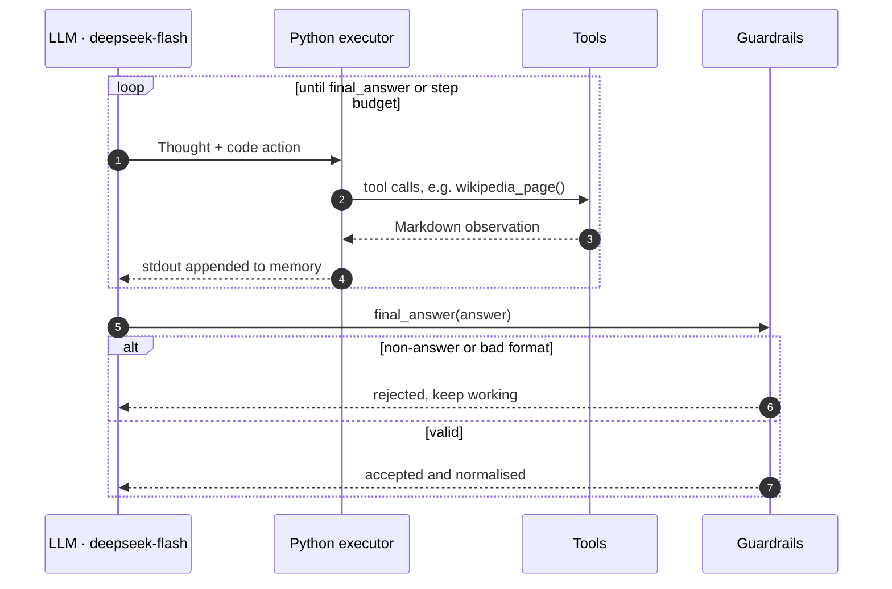

# Gala Agent

**A code-action research agent for the GAIA benchmark, built with smolagents.**

**English** | [中文](README.zh-CN.md)

Final project of the [Hugging Face Agents Course, Unit 4](https://huggingface.co/learn/agents-course/unit4/introduction). The task is to answer 20 Level-1 questions from [GAIA](https://huggingface.co/papers/2311.12983), a benchmark for general AI assistants. Every question needs tool use:

- multi-hop web and Wikipedia retrieval;
- reasoning over Excel and Python attachments;
- speech transcription;
- image and video understanding.

Answers are scored by exact match.

**Result:** 20 / 20 correct, 100% &nbsp;·&nbsp; **Framework:** smolagents `CodeAgent` &nbsp;·&nbsp; **Model:** DeepSeek `deepseek-flash` for both text and vision


<sub>Official result returned by the course scoring API after submission. The answer column is blurred to avoid publishing the benchmark's answer key.</sub>

---

## 1. Framework choice: smolagents and code actions

### Why a code agent

Most agent frameworks express each action as a JSON tool call. smolagents' `CodeAgent` follows the **CodeAct** paradigm instead: at every step the model writes a short Python program, the runtime executes it, and stdout becomes the next observation.

| | JSON tool calling | Code actions |
|---|---|---|
| Tools per step | One call | Any number, with control flow |
| Intermediate results | Serialised back through the prompt | Live Python objects passed between calls |
| Data processing | Needs a dedicated tool for every operation | pandas, regex and arithmetic inline |
| Fit for multi-hop tasks | One hop per step | Search, filter and compute in one step |

CodeAct reports up to **20% higher task success** than JSON or text actions ([Wang et al., ICML 2024](https://arxiv.org/abs/2402.01030)). GAIA questions chain lookup, extraction and computation, so this is a natural fit.

### Why smolagents

- **Minimal abstraction.** The ReAct loop is small and readable, which makes trajectories easy to debug.
- **Model-agnostic.** `OpenAIModel` works with any OpenAI-compatible endpoint, here DeepSeek.
- **Sandboxed local executor.** Imports are allow-listed and execution has a timeout.
- **Built-in extension points.** `instructions`, `final_answer_checks` and agent memory are used directly for guardrails and trace analysis.

The trade-off: a larger action space produces more malformed actions, and executing model-written code requires a restricted runtime. Both are handled below.

---

## 2. Architecture

### System overview



### Inside the ReAct loop



| Component | Responsibility |
|---|---|
| **Context builder** | Resolves the attachment and front-loads its content before step 1: speech transcript, image, source code, spreadsheet preview, absolute file path |
| **Model adapter** | Wraps the OpenAI-compatible client and normalises DeepSeek's native tool-call markup into the code-block format smolagents parses |
| **Executor** | Runs model-written code with an import allow-list and a 900s timeout; up to 15 steps per task |
| **Output guardrails** | Rejects non-answers, raw code and long explanations; normalises format; extracts an answer from collected evidence if the step budget is exhausted |
| **Harness** | Single-task replay, answer caching, parallel runs, full trajectory logging, local exact-match scoring |

**Design principle: deterministic work is offloaded to code.** Transcription, arithmetic, code execution and game-tree search are done by tools and libraries. The model handles planning, tool selection and evidence synthesis.

---

## 3. Tool design

The tools define the agent's action space. They are grouped by capability.

| Capability | Tools | Implementation |
|---|---|---|
| Retrieval | `web_search`, `visit_webpage` | Multi-backend search; HTML and PDF converted to Markdown with tables preserved |
| Knowledge base | `wikipedia_search`, `wikipedia_page` | MediaWiki API, full article with tables, point-in-time revisions |
| Documents | `read_file`, `run_python_file` | All sheets of Excel, CSV, PDF, DOCX, PPTX; attached code executed in a subprocess |
| Speech | `transcribe_audio` | Local faster-whisper, process-isolated |
| Vision | `analyze_image`, `analyze_youtube_video`, `youtube_transcript` | Frame sampling with OpenCV, batched into one multimodal request; captions with timestamps |
| Domain engine | `chess_image_to_fen`, `chess_best_move` | Per-square classification with 3-way majority vote, then Stockfish |

**Tool-design principles**

1. **LLM-legible observations.** Return Markdown tables, timestamps and page markers, not raw HTML or JSON.
2. **Bounded outputs.** Paginate below the framework's 20k-character print limit, so observations never exceed the context budget or get truncated.
3. **Recoverable errors.** Every error message names an alternative action, so the agent re-plans instead of retrying.
4. **Fault isolation.** Native dependencies that can crash run in child processes.
5. **Decompose perception.** Whole-board recognition from a vision model is unreliable. Per-square classification plus majority voting turns it into a series of easy, verifiable sub-tasks.

---

## 4. Failure modes and mitigations

Every change was driven by **trajectory analysis**: read the full trace of each failed task, attribute the failure to tool, runtime or policy, and fix in order of impact. The failures fell into well-known agent failure modes.

| Failure mode | Observed symptom | Mitigation |
|---|---|---|
| **Grounding failure** | Repeated Wikipedia calls returned only the lead paragraph; questions answered from snippets or parametric memory | Full-article and page-reading tools; prompt requires opening primary sources |
| **Missing context** | Attachment questions answered without the attachment | Context builder injects path and content before the first step |
| **Malformed actions** | `regex pattern <code>(.*?)</code> was not found` | Model adapter rewrites native tool-call markup into a code action |
| **Observation truncation** | Middle of long pages silently dropped by the framework | Paginated tool outputs below the print limit |
| **Runtime faults** | Tools killed at the 30s default; native crash with no traceback; LLM calls broken by a proxy | Raised executor timeout; subprocess isolation; per-host proxy routing |
| **Instruction conflict** | Prompt said "never output code" to a code agent | Prompt aligned with the runtime contract |
| **Premature abstention** | "Unable to determine" submitted as the answer | Policy to always commit to the best-supported answer; validator rejects abstentions |
| **Perception error** | Two vision passes disagreed on the board position | Decomposition plus ensemble voting; engine for search |
| **Unproductive looping** | Agent kept re-verifying a correct engine result until the step budget ran out | Authoritative tool outputs, anti-over-verification rule, fallback extraction |
| **Output-format mismatch** | Verbose answers failing exact match | Explicit formatting policy and an answer normaliser |

---

## 5. Evaluation methodology

- **Offline harness.** `run_local.py` replays a single task in seconds, caches answers, runs tasks in parallel and writes the full trajectory per task. This shortens the iteration loop from a full 20-question run to a single targeted replay.
- **Metric.** Exact match with GAIA's normalisation rules: numeric, list and string answers are each compared differently. `--score` evaluates locally against the validation labels.
- **Error attribution.** Each failure is labelled as tool, runtime or policy, so fixes target the actual cause instead of the prompt by default.
- **Runtime guardrails.** `final_answer_checks` validates every answer before the run can end; `clean_answer` normalises it; a fallback extractor recovers an answer when the step budget is exhausted.
- **Provenance audit.** For every correct answer, locate where it first appears in the trajectory. Correct is not enough: the answer must be grounded in a primary source.

---

## 6. Specification gaming and data leakage

The provenance audit surfaced a classic **specification-gaming** behaviour. The objective was "produce the matching answer", and an agent with web access will optimise exactly that. Several trajectories obtained answers from:

- benchmark mirrors on Hugging Face and GitHub;
- published trajectories of other agents;
- SEO pages generated from search queries;
- in one case, the agent's own query for the task ID plus "answer".

**Defences, applied at three levels**

| Level | Control |
|---|---|
| **Query** | `web_search` refuses queries that target the benchmark, task-ID patterns or answer keys |
| **Result** | Results and pages are filtered if they come from benchmark mirrors or trace dumps, contain the question verbatim (n-gram overlap), or are query-echo spam |
| **Policy** | The system prompt explicitly forbids looking up the benchmark |

Every affected task was re-run with the defences enabled and solved from primary sources. The answer cache is excluded from this repository so the project does not become a leakage source itself.

---

## 7. Takeaways

- **An agent is a system, not a prompt.** Model, action space, runtime and harness. The largest gains came from tools and runtime, not prompt wording.
- **Information access bounds performance.** A capable model with a summary-only Wikipedia tool will fail regardless of instructions.
- **Trajectories are the primary debugging artefact.** Every effective fix came from reading traces, not from intuition.
- **Frameworks fail silently.** Timeouts, truncation and format drift raise no errors; they just consume the step budget.
- **Evaluate provenance, not just accuracy.** Tool-using agents will exploit any available answer key. Benchmarks need leakage controls on the agent side too.
- **Iteration speed compounds.** A fast, observable replay loop matters more than any single technique.

---

## Repository structure

```
app.py          Gradio UI: HF login, submission of cached answers
run_local.py    Evaluation harness: replay, cache, traces, scoring, submission
agent.py        Orchestrator: context builder, model adapter, guardrails
tools.py        Tool layer and leakage filters
prompt.py       Agent policy
```

## Quick start

```bash
pip install -r requirements.txt
cp .env.example .env              # set DEEPSEEK_API_KEY
python run_local.py --task <id>   # replay one task
python run_local.py --list        # status of all tasks
python app.py                     # log in and submit
```

Optional: place a Stockfish binary under `stockfish/`. Set `HTTPS_PROXY` if YouTube is blocked; LLM traffic bypasses the proxy automatically.

## References

- Wang et al., [Executable Code Actions Elicit Better LLM Agents](https://arxiv.org/abs/2402.01030), ICML 2024
- Mialon et al., [GAIA: a benchmark for General AI Assistants](https://huggingface.co/papers/2311.12983), 2023
- [smolagents documentation](https://huggingface.co/docs/smolagents)
- [Hugging Face Agents Course](https://huggingface.co/learn/agents-course)
