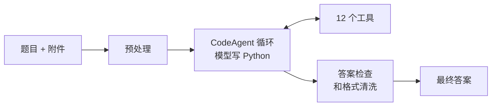

# Gala Agent

[English](README.md) | **中文**

[Hugging Face Agents Course 第 4 单元](https://huggingface.co/learn/agents-course/zh-CN/unit4/introduction)的期末项目：做一个 agent，回答 [GAIA](https://huggingface.co/gaia-benchmark) benchmark 的 20 道题。每道题都需要真的动手：多跳网页检索、读 Wikipedia 表格、分析 Excel 或 Python 附件、转写音频、看 YouTube 视频，或者根据棋盘图片下一步棋。评分方式是精确匹配。

**成绩：** `<SCORE>` / 20  
**技术栈：** smolagents · DeepSeek `deepseek-flash` 负责文本和视觉 · faster-whisper · Stockfish · yt-dlp · OpenCV · Gradio

---

## 1. Agent 设计

**框架。** agent 基于 smolagents 的 `CodeAgent`。模型每一步写的是一段 Python，而不是 JSON 格式的工具调用。一步之内就能调用多个工具、循环处理结果、用 pandas 计算，很适合 GAIA 这种多跳题目。



**三条设计原则**

1. **第一步就把信息给全。** 循环开始前先处理附件：音频转成文字，图片直接附上，代码和表格放预览，文件路径写进题目。
2. **确定的事交给代码。** 转写、表格计算、运行附件代码、象棋搜索，都由工具和库完成，不让模型"心算"。
3. **模型负责决策和整合。** 它只决定下一步做什么，再把证据整合成答案。

## 2. 工具设计

| 类别 | 工具 | 设计要点 |
|---|---|---|
| 网页 | `web_search`、`visit_webpage` | 网页转成保留表格的 Markdown，支持 PDF，长页面分页 |
| Wikipedia | `wikipedia_search`、`wikipedia_page` | 读全文和表格，可以读取指定日期的历史版本 |
| 文件 | `read_file`、`run_python_file` | Excel 读全部工作表和行，附件代码真实运行 |
| 音频 | `transcribe_audio` | 本地 Whisper，放在子进程里运行 |
| 视觉 | `analyze_image`、`analyze_youtube_video` | 视频抽帧后一次性交给视觉模型 |
| 视频字幕 | `youtube_transcript` | 带时间戳的字幕 |
| 象棋 | `chess_image_to_fen`、`chess_best_move` | 棋盘切成 64 格、3 遍投票，再交给 Stockfish |

**写工具的几条原则**

- **返回模型读得懂的文本。** 用 Markdown 表格、时间戳和页码标记，不直接返回原始 HTML 或 JSON。
- **失败时给出下一步。** 报错信息里写明可以改用什么方法，让 agent 换思路，而不是原样重试。
- **适配框架的限制。** 输出按框架的打印上限分页，慢工具的耗时控制在执行时限内。
- **隔离不稳定的依赖。** 可能崩溃的底层库放进子进程，单次失败不会拖垮整个运行。
- **把难的感知任务拆开。** 让视觉模型描述整张棋盘不可靠，一次只判断一个格子、再投票，就可靠了。

## 3. 遇到的问题和解决

每一处修改都来自读失败题目的执行日志。

| 日志里看到的现象 | 原因 | 解决 |
|---|---|---|
| 反复查 Wikipedia，返回的都是同一段简介 | 工具调用的是摘要接口 | 改为获取解析后的全文 |
| 附件题基本靠猜 | agent 根本不知道附件路径 | 预处理时写入路径和内容 |
| 大量回答 "Unable to determine" | prompt 要求模型表达不确定 | 始终给出依据最充分的答案，拦截非答案 |
| 解析报错：找不到 `<code>` 代码块 | DeepSeek 有时用自己的工具调用格式 | 模型适配层把它改写成代码块 |
| 工具运行到一半被杀掉 | 每段代码默认只给 30 秒 | 放宽执行时限 |
| 长网页中间的内容悄悄丢失 | 框架会截掉超过 2 万字符的输出 | 工具输出按 1.5 万字符分页 |
| Windows 上进程直接退出、没有报错 | 音频相关的底层库原生崩溃 | 转写放进子进程 |
| 开代理后每次调用模型都失败 | 代理把模型请求也拦了 | 只让 YouTube 走代理 |
| 棋盘识别前后不一致 | 视觉模型不擅长描述整张棋盘 | 逐格识别加投票，走法交给 Stockfish |
| 已拿到正确的引擎结果，还在反复验证直到步数用完 | 过度验证 | 工具输出写明结果可信，prompt 禁止重复验证，兜底提取答案 |

## 4. 怎么评估 agent 的输出

- **本地按精确匹配打分。** `run_local.py --score` 采用 GAIA 的归一化规则，数字、列表、字符串各有不同的比较方式。
- **每题都有完整日志。** 每次运行记录每一步。失败原因按工具、框架、prompt 三类归档，按影响大小依次修。
- **守住最终答案。** 非答案、代码、长篇解释都会被打回，agent 继续工作；答案统一清洗格式；步数用完时，从已收集的证据里提取答案。
- **审查证据来源。** 对每个答案，都在日志里查它最早从哪里出现。正确答案必须来自原始资料，而不是来自本来就写着答案的地方。

## 5. 当 agent 作弊时

证据审查发现，有些答对的题，答案来自不该来的地方：

- Hugging Face 和 GitHub 上转载 benchmark 的数据集；
- 别人公开的 agent 运行记录；
- 用别人的搜索词自动生成的 SEO 页面；
- 有一条日志里，agent 自己去搜了"task ID + answer"。

**应对措施**

- `web_search` 拒绝针对 benchmark 或 task ID 的搜索。
- 来自 benchmark 转载和运行记录的结果，以及原样包含题目文字的页面，都会被过滤。
- prompt 明确禁止查找 benchmark 本身。
- 受影响的题开启过滤后全部重跑，都从原始资料得出答案：视频本身、Wikipedia 特色条目记录、教材原文。
- 答案缓存不公开，这个仓库本身也不会变成泄露源。

## 6. 对 agent 的理解

- **Agent 不只是 prompt。** 它是模型、工具、循环，再加上外围的工程。大部分提升来自工具和外围工程，而不是 prompt 措辞。
- **瓶颈在信息，不在智力。** 模型读不到表格时，指令写得再好也没用。
- **先看日志，再动手。** 这里每一个真正有效的修复都来自日志，而不是猜测。
- **框架会悄悄出错。** 超时、截断、格式不匹配都不会报错，只会默默消耗步数。
- **高分需要审查。** 能上网的 agent，只要答案存在就会找到它。评估时必须检查答案从哪里来。
- **快速反馈比技巧更重要。** 单题运行、答案缓存、每题日志，让几小时的瞎猜变成每轮几分钟的迭代。

---

## 项目结构

```
app.py          Gradio 页面：登录并提交缓存的答案
run_local.py    开发循环：单题运行、答案缓存、日志、本地打分
agent.py        预处理、CodeAgent 循环、答案检查
tools.py        12 个工具和防泄露过滤
prompt.py       agent 的指令
```

## 快速开始

```bash
pip install -r requirements.txt
cp .env.example .env           # 填入 DEEPSEEK_API_KEY
python run_local.py --task <id>
python run_local.py --list
python app.py
```

可选：把 Stockfish 放在 `stockfish/` 下。如果网络访问不了 YouTube，设置 `HTTPS_PROXY`。
