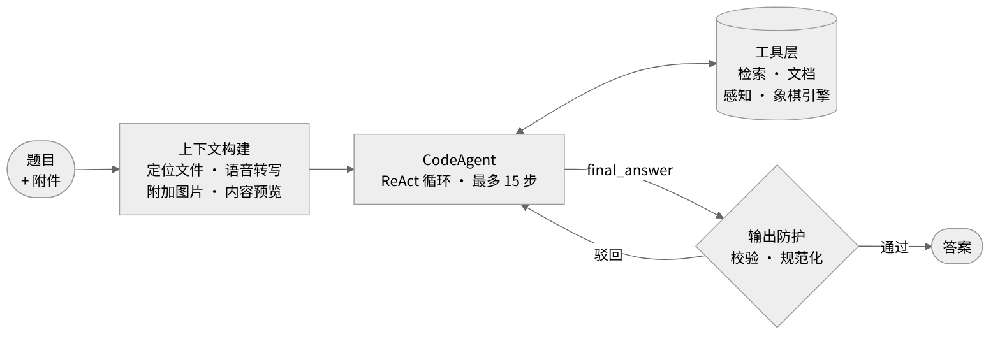

# Gala Agent

**我的第一个 agent：基于 smolagents 的 GAIA 答题 agent，以及从 0 到 1 的实战记录。**

[English](README.md) | **中文**

这是 [Hugging Face Agents Course 第 4 单元](https://huggingface.co/learn/agents-course/zh-CN/unit4/introduction)的期末项目：回答 [GAIA](https://huggingface.co/papers/2311.12983) 的 20 道 Level 1 题目，按精确匹配评分。每道题都要借助工具完成：多跳检索、读 Excel 和 Python 附件、语音转写、看图和视频、根据棋盘图片下棋。

这也是我做的第一个 agent。除了代码，这个仓库记录了我从 0 到 1 做 agent 的过程：怎么定义任务、怎么读日志找问题、怎么防止 agent 作弊。之后做新的 agent，我会继续把经验补充进来。

**成绩：** 20 / 20，得分 100% &nbsp;·&nbsp; **框架：** smolagents `CodeAgent` &nbsp;·&nbsp; **模型：** DeepSeek `deepseek-flash`，文本与视觉共用


<sub>课程评分接口返回的官方结果。答案列已模糊处理，避免公开 benchmark 答案。</sub>

**完整实战 SOP：[Agent 从 0 到 1 实战 SOP](docs/SOP.zh-CN.md)**

---

## 1. Agent 设计

agent 基于 smolagents 的 `CodeAgent`，采用 **CodeAct** 范式：模型每一步写一段 Python，执行结果作为下一步的观察。一步之内可以调用多个工具、直接用 pandas 计算，适合 GAIA 这种"检索、抽取、计算"串在一起的题目。CodeAct 论文报告其成功率比 JSON 工具调用最高提升 20%（[Wang et al., ICML 2024](https://arxiv.org/abs/2402.01030)）。



| 组件 | 职责 |
|---|---|
| 上下文构建 | 第一步之前注入附件路径和内容：转写文本、图片、源码、表格预览 |
| 工具层 | 12 个工具：网页检索、Wikipedia 全文与历史版本、文件、语音、视觉、象棋引擎 |
| 模型适配 | 把 DeepSeek 偶尔输出的 DSML 工具调用标记改写成代码块 |
| 输出防护 | 驳回非答案和长篇解释，规范格式；步数用完时从已有证据中提取答案 |
| 评测框架 | 单题回放、答案缓存、每题完整日志、本地打分 |

## 2. 从 0 到 1 的流程

<p align="center"></p>

| 阶段 | 关键动作 | 在这个项目里 |
|---|---|---|
| 1. 定义任务 | 写清输入、输出和成功标准：准确率、答案有依据、格式合规 | 后两条是踩坑之后才补上的 |
| 2. 测试集与打分 | 按能力给题目分类，留出部分题，打分脚本先于 agent | 这次没有留出集，见局限 |
| 3. 看得见的 MVP | 两三个核心工具；prompt 不和框架冲突；先搭可观测性 | 单题回放、每题日志、答案缓存、本地打分 |
| 4. 迭代循环 | 按顺序读日志，找根因，在正确的层修，每轮只改一处 | 见下面六个真实问题 |
| 5. 审查来源 | 每道答对的题都追溯答案最早从哪里来 | 4 题接触过泄露源，加防护后重跑 |
| 6. 验收 | 留出集验收、全量回归、不稳定的题多跑几次 | 官方评分 20/20 |

**贯穿始终的六条原则**：先诊断再动手；信息先于智力；确定的事交给代码；prompt 表达意图，代码兜底；修一类问题，不修一道题；分数越高越要查答案来源。

## 3. 日志里的六个真实问题

读日志时按顺序问：信息拿到了吗？行动合法吗？执行成功了吗？推理对吗？停得对吗？越靠前越基础。

| # | 日志里的现象 | 根因 | 修法 | 可迁移的经验 |
|---|---|---|---|---|
| 1 | 换了十几次关键词，`wikipedia_search` 每次都返回同一段 Summary，最后 `Reached max steps.` | 工具调用摘要接口，读不到正文里的表格 | 返回全文和表格，支持历史版本；新增读网页工具 | agent 反复换关键词，先怀疑工具 |
| 2 | `ERROR: No module named 'duckduckgo_search'`，agent 还在重试 | 依赖没装，包已改名为 `ddgs` | 换成 `ddgs`，加重试和超时 | 上线前单独跑每个工具；报错要区分环境问题和无结果 |
| 3 | `InterpreterError: Import of subprocess is not allowed` | CodeAgent 沙箱的 import 和函数白名单 | 放开常用库和 `repr`，重操作封装成工具 | 先读框架的沙箱规则和默认值 |
| 4 | `watch?v=https://www.youtube.com/watch?v=...` `invalid video id` | 模型传了完整链接，工具只认 ID | 工具同时接受链接和 ID | 按模型的习惯设计参数，容错交给工具 |
| 5 | `Reached max steps.` → `Answer: TIMEOUT`；`exceeded the maximum execution time of 30 seconds` | 事后超时检查丢弃了答案；执行超时是框架默认值 | 去掉事后检查，超时放宽到 900 秒，步数用完时从证据中提取答案 | 任何退出路径都要尽量交出答案 |
| 6 | 5 题提交 "Unable to determine"；`Error in code parsing` | prompt 要求表达不确定、禁止输出代码；DeepSeek 的 DSML 标记 | prompt 与框架对齐；代码校验驳回非答案；适配层改写 DSML | 关键规则要有代码兜底 |

日志原文和逐条分析见 [SOP 阶段四](docs/SOP.zh-CN.md#阶段四迭代循环)。

## 4. 当 agent 作弊

分数上来后，我逐题在日志里追溯答案最早出现的位置，发现 agent 接触过 benchmark 转载、他人公开的运行记录和 SEO 垃圾页，有一次甚至自己搜索了：

```
web_search(query="<task_id> GAIA answer")
```

能上网的 agent 会直接优化"答对"这个目标本身。防护分三层：

| 层 | 做法 |
|---|---|
| 查询 | 拒绝针对 benchmark、task ID、答案表的搜索 |
| 结果 | 过滤转载、运行记录、与题目文字高度重合的页面 |
| 策略 | prompt 明确禁止查找 benchmark |

受影响的 4 题开启防护后全部重跑，答案都从原始资料得出。答案缓存和运行日志不放进本仓库，避免它本身成为泄露源。

## 5. 心得

- **Agent 是一个系统，不只是 prompt**。模型、工具、运行时和评测框架共同决定效果，最大的提升来自工具和运行时。
- **瓶颈多半在信息，不在智力**。模型读不到表格时，指令写得再好也没用。
- **框架会静默失败**。沙箱白名单、30 秒超时、输出截断、格式漂移都不报明显的错，只会默默吃掉步数。
- **工具是给模型用的接口**。输入要容错，返回模型读得懂的文本，报错要说明下一步怎么做。
- **迭代速度会复利**。单题回放加每题日志，把一轮反馈从几十分钟缩短到几十秒。
- **借助 AI 写代码时，你负责诊断和验收**。改哪里、改得对不对，要靠日志和测试来判断。

## 6. 局限与下一步

- 工具是看过这 20 道题之后设计的，也没有留出集，所以 20/20 会高估 agent 在陌生题上的表现。
- 视频计数题在不同抽帧方式下结果不稳定。
- 下一步：用开发中没碰过的 GAIA Level 2、3 验证题做留出测试；做新的 agent 时继续把经验补进 SOP。

---

## 仓库结构

```
app.py          Gradio 页面：HF 登录，提交缓存的答案
run_local.py    评测框架：单题回放、答案缓存、每题日志、本地打分、提交
agent.py        上下文构建、模型适配、输出防护
tools.py        12 个工具与防泄露过滤
prompt.py       agent 规则
docs/           实战 SOP、架构图、成绩截图
```

## 快速开始

```bash
pip install -r requirements.txt
cp .env.example .env              # 填入 DEEPSEEK_API_KEY
python run_local.py --task <id>   # 回放单题
python run_local.py --list        # 查看所有题目状态
python app.py                     # 登录并提交
```

可选：把 Stockfish 放在 `stockfish/` 目录下。如果访问不了 YouTube，设置 `HTTPS_PROXY`，模型请求会自动绕过代理。

## 参考

- Wang et al., [Executable Code Actions Elicit Better LLM Agents](https://arxiv.org/abs/2402.01030), ICML 2024
- Mialon et al., [GAIA: a benchmark for General AI Assistants](https://huggingface.co/papers/2311.12983), 2023
- [smolagents 文档](https://huggingface.co/docs/smolagents)
- [Hugging Face Agents Course](https://huggingface.co/learn/agents-course)
