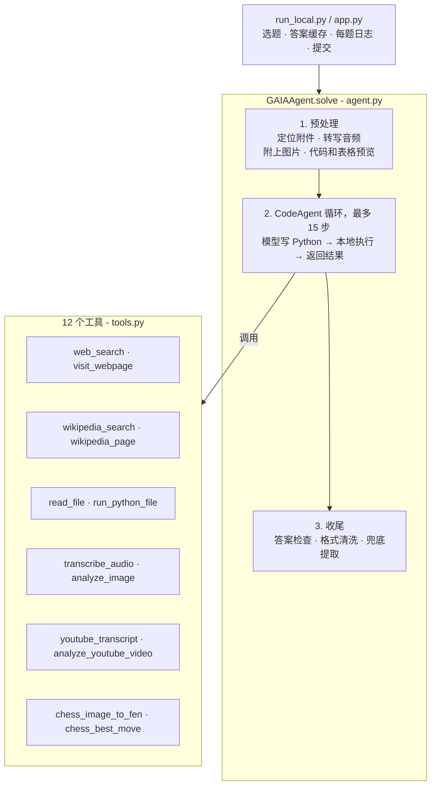

# GAIA Agent：一个能用工具做研究的 GAIA 答题 agent

[English](README.md) | **中文**

基于 [smolagents](https://github.com/huggingface/smolagents) 和 DeepSeek 的单 agent 系统，用来回答 [GAIA](https://huggingface.co/gaia-benchmark) benchmark 的题目（Hugging Face Agents Course 第 4 单元使用的 Level 1 子集）。每道题都要真的去查资料：多跳网页检索、读 Wikipedia 表格、解析 Excel 或 Python 附件、转写音频、看 YouTube 视频，或者根据棋盘图片下一步棋。评分方式是精确匹配。

| | |
|---|---|
| **成绩** | 课程的 GAIA Level 1 评测集 `<SCORE>` / 20（务必先看 [评测与局限](#评测与局限)） |
| **技术栈** | Python · smolagents `CodeAgent` · DeepSeek API（`deepseek-flash`，文本和视觉共用）· faster-whisper · python-chess + Stockfish · yt-dlp + OpenCV · Gradio |
| **成本** | 除了大模型，不用任何付费 API。搜索、音频、象棋、视频都是免费或在本地跑 |

---

## 架构



核心设计原则：**能用代码确定完成的事，都交给代码；模型只负责决定下一步做什么、整合证据。**

| 层 | 职责 |
|---|---|
| **预处理**（`build_task`） | agent 开始前先找到附件并把内容放进题目：音频转成文字，图片直接附上，Python 源码和表格预览直接写入。模型第一步就拿到全部输入。 |
| **推理循环** | smolagents `CodeAgent`。每一步模型写一段 Python，调用工具或库（pandas、python-chess），执行结果作为下一步的输入。 |
| **模型适配** | `DeepSeekModel` 把 DeepSeek 自带的工具调用格式改写成 smolagents 需要的 `<code>` 代码块。 |
| **答案兜底** | `answer_check` 拦截非答案（"无法确定"、代码、长篇解释），让 agent 回去继续做；`clean_answer` 统一格式；步数用完时 `_rescue_answer` 从已收集的证据里提取答案。 |
| **开发循环** | `run_local.py`：单题运行、答案缓存、每题完整日志、并行运行、本地打分、提交。 |

### 工具

| 工具 | 实现 |
|---|---|
| `web_search` | ddgs（DuckDuckGo / Bing / Brave），带重试和**防泄露过滤**（见下文） |
| `visit_webpage` | 网页转 Markdown（保留表格），支持 PDF，分页读取 |
| `wikipedia_search` / `wikipedia_page` | MediaWiki API 读全文和表格，`as_of_date` 可读取历史版本 |
| `read_file` | Excel（所有工作表、所有行）、CSV、PDF、Word、PPT、纯文本 |
| `run_python_file` | 在子进程里实际运行附件代码，返回输出 |
| `transcribe_audio` | 本地 faster-whisper，在独立子进程中运行 |
| `analyze_image` | DeepSeek 视觉 |
| `youtube_transcript` / `analyze_youtube_video` | 读字幕；或用 yt-dlp 下载、OpenCV 抽帧后交给视觉模型 |
| `chess_image_to_fen` | 把棋盘切成 64 格分别识别，跑 3 遍投票，根据坐标标签判断棋盘方向 |
| `chess_best_move` | Stockfish（找不到时用内置的简单 alpha-beta 搜索兜底） |

---

## 遇到的难题和解决过程

第一版（v1）效果很差。我停下了调 prompt，**逐题去读失败题目的执行日志**。结果发现几乎没有一题是"模型不够聪明"导致的，都是基础设施的问题，可以归成四类。

### 1. agent 拿不到信息

| 现象（来自日志） | 根因 | 解决 |
|---|---|---|
| 一道唱片统计题，查了 6 次 Wikipedia，返回的都是同一段简介 | 工具调的是 REST 摘要接口，且只取第 1 条结果 | `wikipedia_page` 返回解析后的全文（含表格），并支持 `as_of_date`，应对"使用 2022 年版本"这类要求 |
| 研究类题目只能靠搜索摘要或模型记忆作答 | 没有打开网页的工具，prompt 却声称能浏览网页 | 新增 `visit_webpage`（网页和 PDF 转 Markdown，可分页） |
| 所有搜索都失败 | 搜索依赖没装，而且包已经改名 | 改用 `ddgs`，加上重试和超时 |
| 5 道附件题基本靠猜 | 只处理了图片，agent 从来不知道附件路径 | 预处理时写入绝对路径和内容（转写文字、源码、表格预览） |
| 音频题无法作答 | 没有音频工具 | 本地 faster-whisper |

### 2. 框架在悄悄浪费步数

这类问题不会报明显的错误，只能在日志里看到。

| 现象 | 根因 | 解决 |
|---|---|---|
| `regex pattern <code>(.*?)</code> was not found` | DeepSeek 有时输出自己的工具调用格式，而不是代码块 | 写了一个模型子类，在 smolagents 解析前把它改写成 `<code>` 代码块 |
| `Code execution exceeded the maximum execution time of 30 seconds` | smolagents 默认每段代码只给 30 秒，音频、视频、象棋工具跑到一半就被杀掉 | 执行时限放宽到 900 秒 |
| 长网页的中间一段内容丢失 | smolagents 对超过 2 万字符的输出会从**中间**截掉一段 | 工具按 1.5 万字符分页，并告诉 agent 怎么继续读 |
| Windows 上进程直接退出，没有任何报错 | faster-whisper / PyAV 这一层发生了原生崩溃 | 转写放到开了 `faulthandler` 的子进程里，崩溃只影响这一次工具调用 |
| 每个 Wikipedia 页面都报 `SelectorSyntaxError` | bs4 依赖的 CSS 选择器版本不兼容 | 改用普通的 `find_all` 过滤 |
| 为 YouTube 开了代理后，每次调用模型都报 `Connection error` | 代理把 DeepSeek 的请求也拦了过去 | 给模型接口设 `NO_PROXY`，只有 YouTube 走代理 |

### 3. 规则在逼它丢分

| v1 的规则 | 后果 | 解决 |
|---|---|---|
| "不要输出 Python 代码" | 和 CodeAgent 的机制冲突（它就是靠代码块来行动的）：出现解析错误，还有一题把代码原样当答案交了 | 删除，prompt 改成和框架一致 |
| "明确表达不确定" | 5 题回答 "Unable to determine…"，每题都是 0 分 | 改成始终给出依据最充分的答案，非答案由 `answer_check` 打回 |
| 没有答案格式规则 | 回答太长，精确匹配失败 | 写明 GAIA 的格式规则，加上 `clean_answer` |
| 跑完后才检查超时 | 已经算出来的答案被丢掉，换成了 "TIMEOUT" | 删除，运行时长改由步数上限和各工具自己的超时控制 |

### 4. 需要换一种拆法的问题

**根据图片下棋。** 视觉模型描述整张棋盘时前后不一致（两次识别的棋子位置对不上），语言模型本身也不会搜索走法。我把任务拆给各自擅长的部分：

1. 把棋盘切成 64 格，每格单独识别。识别一个格子里是什么，比描述整张棋盘简单得多。
2. 跑 3 遍，每格按多数投票，不一致的格子单独标出来。
3. 根据坐标标签判断白方还是黑方在下面，用代码把识别结果转换成 FEN。
4. 把 FEN 交给 Stockfish。

结果 FEN 完全正确，第 3 步引擎就给出了着法。

**过度验证。** 已经拿到正确的引擎结果后，agent 又花了 12 步试图"证明"必胜，最后没能交出干净的答案。修复：工具输出直接写明结果可信、不需要再验证；prompt 里加一条规则，可靠结果不要反复验证；最后再加上兜底提取。

### 5. 数据泄露：发现并堵上

分数提升之后，我回头查了每道题的日志，看每个答案**最早是从哪里出现的**，发现有 4 题接触过泄露源：

- Hugging Face 和 GitHub 上转载 benchmark 的数据集；
- 别人公开的 agent 运行记录；
- 用别人的搜索词自动生成的 SEO 页面，有时里面直接带着答案；
- 其中一条日志里，agent 甚至自己去搜了 "`<task_id>` GAIA answer"。

在 `tools.py` 里做了这几处防护：

- `web_search` 拒绝针对 benchmark 本身的搜索（名称、task id 格式、"answer key" 等）。
- 来自 benchmark 数据集或运行记录的结果、原样包含题目文字的页面、用搜索词生成的垃圾页，都会被过滤掉。
- prompt 里明确禁止搜索 benchmark 本身。

这 4 题在开启过滤后全部重跑，都从原始来源得出了答案：视频原画面、Wikipedia 特色条目记录、教材原文，以及在代码里做的植物学分类。出于同样的原因，答案缓存没有放进这个仓库。

---

## 评测与局限

请先读这一节，再看分数。

- **针对测试集做了优化。** 工具是在看过这 20 道题之后设计的（比如象棋流程、读取 Wikipedia 历史版本），所以这个分数**会高估 agent 在陌生题目上的表现**。
- **模型可能背过题。** 这些题目是公开的，模型训练时可能见过。每个答案都有工具调用记录作为依据，但记录没法证明模型不是"先知道答案、再去找证据"。
- **泄露审查**（见上文）发现 4 题被污染，已全部干净地重做。剩下的风险来自模型记忆，而不是检索。
- **视频计数不稳定。** 视频那题，不同抽帧方式下物种数量在 2 和 3 之间摇摆。更稳的做法是在关键时间段加密抽帧，让模型每帧输出结构化结果，再用代码统计。
- **还没有在留出集上测试。** 下一步：用开发过程中完全没碰过的 GAIA Level 2/3 验证题来测。

---

## 项目结构

```
├── app.py            Gradio 页面：HF 登录，提交缓存的答案
├── run_local.py      开发循环：单题运行、答案缓存、每题日志、本地打分、提交
├── agent.py          GAIAAgent：预处理、CodeAgent 循环、答案检查 / 清洗 / 兜底
├── tools.py          12 个工具 + 防泄露过滤
├── prompt.py         追加到 CodeAgent 系统提示后面的规则
├── requirements.txt
└── .env.example      DEEPSEEK_API_KEY 及可选设置
```

没有提交到仓库的：`.env`、答案缓存、运行日志、题目附件和题目文件（GAIA 要求不要二次分发数据）、Stockfish 程序。

## 运行

```bash
pip install -r requirements.txt
cp .env.example .env            # 填入 DEEPSEEK_API_KEY

python run_local.py --list          # 查看所有题目的状态
python run_local.py --task <id>     # 跑单题（task id 前缀）
python run_local.py                 # 跑所有还没有答案的题
python app.py                       # Gradio 页面 → 登录 → 提交
```

可选：把 Stockfish 程序放在 `stockfish/` 下（自动识别），或设置 `STOCKFISH_PATH`。如果网络访问不了 YouTube，设置 `HTTPS_PROXY`，模型的请求会自动绕过代理。

## 致谢

为 [Hugging Face Agents Course](https://huggingface.co/learn/agents-course) 第 4 单元而做。开发过程中借助 AI 编程助手生成和审查代码；问题诊断、设计决策和验证过程记录在上文。
