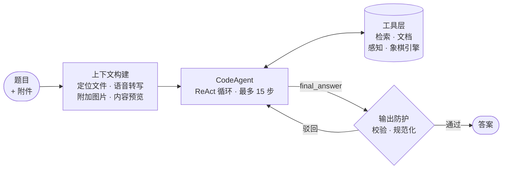
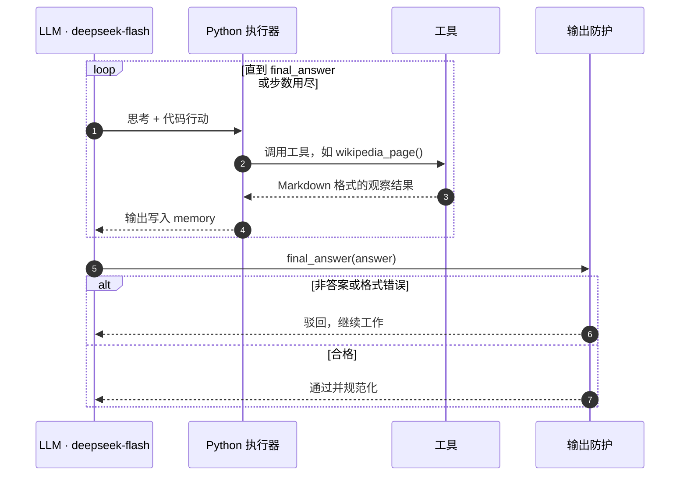

# Gala Agent

**基于 smolagents 与 Code Action 范式的研究型 agent，面向 GAIA benchmark。**

[English](README.md) | **中文**

[Hugging Face Agents Course 第 4 单元](https://huggingface.co/learn/agents-course/zh-CN/unit4/introduction)的期末项目。任务是回答 [GAIA](https://huggingface.co/papers/2311.12983) 的 20 道 Level 1 题目。GAIA 是面向通用 AI 助手的评测基准，每道题都必须借助工具完成：

- 多跳的网页与 Wikipedia 检索；
- 基于 Excel、Python 附件的推理；
- 语音转写；
- 图像与视频理解。

评分方式为精确匹配。

**成绩：** 20 / 20 全部正确，得分 100% &nbsp;·&nbsp; **框架：** smolagents `CodeAgent` &nbsp;·&nbsp; **模型：** DeepSeek `deepseek-flash`，文本与视觉共用


<sub>提交后课程评分接口返回的官方结果。答案列已做模糊处理，避免公开 benchmark 的答案。</sub>

---

## 1. 框架选型：smolagents 与代码行动

### 为什么选代码 agent

多数 agent 框架用 JSON 格式的工具调用表达每一步行动。smolagents 的 `CodeAgent` 采用的是 **CodeAct** 范式：模型每一步写一段 Python，运行时执行这段代码，标准输出作为下一步的观察结果。

| | JSON 工具调用 | 代码行动 |
|---|---|---|
| 每步可调用的工具 | 一次一个 | 任意多个，并支持控制流 |
| 中间结果 | 序列化后经由 prompt 回传 | 以 Python 对象直接在调用间传递 |
| 数据处理 | 每种操作都需要专门的工具 | 直接用 pandas、正则、算术 |
| 多跳任务 | 每步只能前进一跳 | 一步内完成检索、筛选和计算 |

CodeAct 论文报告其任务成功率比 JSON 或文本形式的行动最高提升 **20%**（[Wang et al., ICML 2024](https://arxiv.org/abs/2402.01030)）。GAIA 题目往往需要把检索、抽取和计算串起来，正适合这种范式。

### 为什么选 smolagents

- **抽象层薄。** ReAct 循环的实现小而清晰，执行轨迹容易调试。
- **与模型解耦。** `OpenAIModel` 可以接入任何兼容 OpenAI 接口的服务，这里接的是 DeepSeek。
- **自带沙箱执行器。** import 采用白名单，代码执行有超时限制。
- **扩展点齐全。** `instructions`、`final_answer_checks` 和 agent memory 直接用来实现防护和轨迹分析。

代价是：行动空间更大，模型更容易产出格式错误的行动；执行模型写的代码，也需要受限的运行环境。这两点在下文都有对应处理。

---

## 2. 系统架构

### 整体流程



### ReAct 循环内部



| 组件 | 职责 |
|---|---|
| **上下文构建** | 在第一步之前定位附件并预先注入内容：转写文本、图片、源码、表格预览、文件绝对路径 |
| **模型适配层** | 封装兼容 OpenAI 的客户端，把 DeepSeek 原生的工具调用标记转换成 smolagents 能解析的代码块 |
| **执行器** | 在 import 白名单和 900 秒超时的约束下执行模型代码，每题最多 15 步 |
| **输出防护** | 驳回非答案、原始代码和长篇解释；规范答案格式；步数用尽时从已收集的证据中提取答案 |
| **评测框架** | 单题回放、答案缓存、并行运行、完整轨迹日志、本地精确匹配打分 |

**设计原则：确定性的工作交给代码。** 转写、计算、代码执行、博弈树搜索都由工具和库完成，模型只负责规划、选择工具和综合证据。

---

## 3. 工具设计

工具集合定义了 agent 的行动空间，按能力划分如下：

| 能力 | 工具 | 实现 |
|---|---|---|
| 检索 | `web_search`、`visit_webpage` | 多后端搜索；网页和 PDF 转为保留表格的 Markdown |
| 知识库 | `wikipedia_search`、`wikipedia_page` | MediaWiki API，含表格的全文，支持按日期读取历史版本 |
| 文档 | `read_file`、`run_python_file` | Excel 全部工作表、CSV、PDF、DOCX、PPTX；附件代码在子进程中执行 |
| 语音 | `transcribe_audio` | 本地 faster-whisper，进程隔离 |
| 视觉 | `analyze_image`、`analyze_youtube_video`、`youtube_transcript` | OpenCV 抽帧后合并为一次多模态请求；带时间戳的字幕 |
| 领域引擎 | `chess_image_to_fen`、`chess_best_move` | 逐格分类加三次多数投票，再交给 Stockfish |

**工具设计原则**

1. **观察结果要便于 LLM 理解。** 返回 Markdown 表格、时间戳和页码标记，不返回原始 HTML 或 JSON。
2. **输出有界。** 分页长度低于框架 2 万字符的打印上限，观察结果不会超出上下文预算，也不会被截断。
3. **错误可恢复。** 每条报错都给出可替代的行动，让 agent 重新规划，而不是原样重试。
4. **故障隔离。** 可能崩溃的底层依赖运行在子进程中。
5. **拆解感知任务。** 让视觉模型识别整张棋盘并不可靠；逐格分类再多数投票，就变成了一串简单、可验证的子任务。

---

## 4. 失败模式与对策

所有改动都来自**轨迹分析**：逐题阅读失败任务的完整执行轨迹，把原因归到工具、运行时或策略三类，再按影响大小依次修复。遇到的问题基本对应几种常见的 agent 失败模式：

| 失败模式 | 观察到的现象 | 对策 |
|---|---|---|
| **信息落地失败** | 多次调用 Wikipedia 只拿到导语段；靠搜索摘要或模型参数记忆作答 | 提供全文和网页读取工具；策略要求查阅原始来源 |
| **上下文缺失** | 附件题在没看到附件的情况下作答 | 上下文构建在第一步之前注入路径和内容 |
| **行动格式错误** | `regex pattern <code>(.*?)</code> was not found` | 模型适配层把原生工具调用标记改写为代码行动 |
| **观察结果截断** | 长网页中段被框架静默丢弃 | 工具输出分页，低于打印上限 |
| **运行时故障** | 工具在默认 30 秒处被终止；底层库崩溃且无报错；代理导致模型调用中断 | 放宽执行超时；子进程隔离；按域名分流代理 |
| **指令冲突** | prompt 要求代码 agent "不要输出代码" | 让 prompt 与运行时约定保持一致 |
| **过早放弃作答** | 提交 "Unable to determine" 作为答案 | 策略要求给出依据最充分的答案；校验器驳回放弃式回答 |
| **感知错误** | 两次视觉识别对棋局的判断不一致 | 任务拆解加集成投票；走法交给引擎搜索 |
| **无效循环** | 已拿到正确的引擎结果，仍反复验证直至步数耗尽 | 工具输出标明结果权威；禁止过度验证；兜底提取答案 |
| **输出格式不匹配** | 冗长的回答无法精确匹配 | 明确的格式策略加答案规范化 |

---

## 5. 评测方法

- **离线评测框架。** `run_local.py` 可在几秒内回放单题，缓存答案，并行运行，并为每题写下完整轨迹。迭代单位从"整套 20 题"缩短为"有针对性地回放一题"。
- **指标。** 采用 GAIA 归一化规则的精确匹配，数字、列表、字符串分别比较。`--score` 可在本地对照验证集标签打分。
- **错误归因。** 每个失败都标注为工具、运行时或策略问题，修复针对真正原因，而不是默认去改 prompt。
- **运行时防护。** `final_answer_checks` 在运行结束前校验每个答案；`clean_answer` 统一格式；步数耗尽时由兜底提取器恢复答案。
- **溯源审查。** 对每个答对的题，定位答案在轨迹中最早出现的位置。答对还不够，答案必须有原始来源作为依据。

---

## 6. 规约博弈与数据泄露

溯源审查发现了典型的**规约博弈**（specification gaming）行为：目标是"给出匹配的答案"，一个能上网的 agent 就会直接优化这个目标。部分轨迹的答案来自：

- Hugging Face 与 GitHub 上的 benchmark 转载；
- 其他 agent 公开的运行轨迹；
- 根据搜索词自动生成的 SEO 页面；
- 有一次，agent 自己去搜索"task ID + answer"。

**三层防护**

| 层级 | 措施 |
|---|---|
| **查询层** | `web_search` 拒绝针对 benchmark、task ID 格式或答案表的搜索 |
| **结果层** | 过滤来自 benchmark 转载和轨迹转储的结果、通过 n-gram 重叠检测出的原样包含题目文字的页面，以及回显搜索词的垃圾页 |
| **策略层** | 系统提示明确禁止查找 benchmark 本身 |

所有受影响的题目都在启用防护后重跑，并从原始来源得出答案。答案缓存不纳入本仓库，避免项目本身成为泄露源。

---

## 7. 总结与思考

- **Agent 是一个系统，不是一段 prompt。** 它由模型、行动空间、运行时和评测框架共同组成。最大的提升来自工具与运行时，而不是 prompt 措辞。
- **信息获取决定能力上限。** 一个只能读到 Wikipedia 摘要的强模型，无论指令写得多好都会失败。
- **执行轨迹是首要的调试依据。** 每一个有效修复都来自阅读轨迹，而不是直觉。
- **框架会静默失败。** 超时、截断、格式漂移都不会报错，只会悄悄消耗步数预算。
- **既要评估准确率，也要评估来源。** 能使用工具的 agent 会利用任何可得的答案表，因此 agent 一侧同样需要防泄露机制。
- **迭代速度会复利。** 一个快速、可观测的回放循环，比任何单项技巧都更重要。

---

## 仓库结构

```
app.py          Gradio 页面：HF 登录，提交缓存答案
run_local.py    评测框架：回放、缓存、轨迹、打分、提交
agent.py        编排层：上下文构建、模型适配、输出防护
tools.py        工具层与防泄露过滤
prompt.py       agent 策略
```

## 快速开始

```bash
pip install -r requirements.txt
cp .env.example .env              # 设置 DEEPSEEK_API_KEY
python run_local.py --task <id>   # 回放单题
python run_local.py --list        # 查看所有题目状态
python app.py                     # 登录并提交
```

可选：把 Stockfish 放在 `stockfish/` 目录下。如果访问不了 YouTube，设置 `HTTPS_PROXY`，模型请求会自动绕过代理。

## 参考

- Wang et al., [Executable Code Actions Elicit Better LLM Agents](https://arxiv.org/abs/2402.01030), ICML 2024
- Mialon et al., [GAIA: a benchmark for General AI Assistants](https://huggingface.co/papers/2311.12983), 2023
- [smolagents 文档](https://huggingface.co/docs/smolagents)
- [Hugging Face Agents Course](https://huggingface.co/learn/agents-course)
