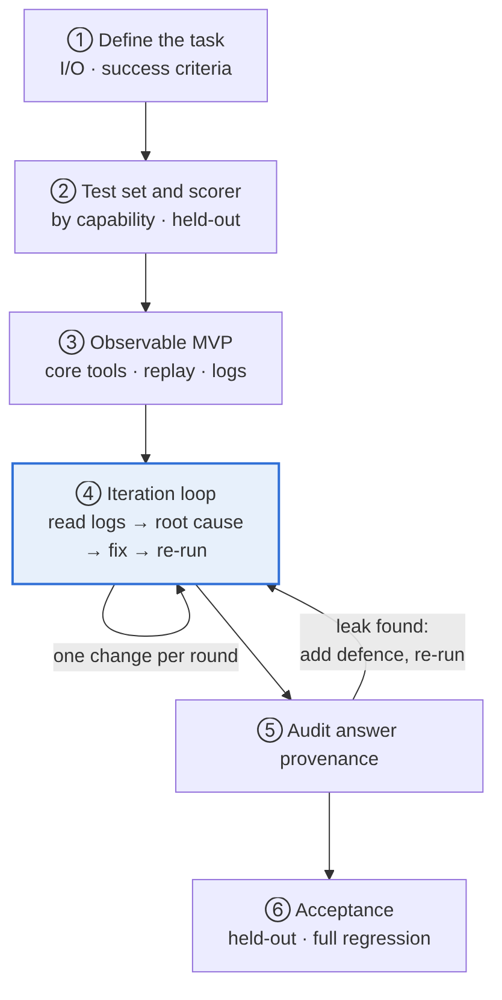

# Building an Agent from 0 to 1: A Field SOP, Using the GAIA Agent as the Case

**English** | [中文](SOP.zh-CN.md) · [Back to README](../README.md)

A good agent is not written right the first time. It comes out of a loop: **run → read the logs → find the root cause → fix → verify**. This SOP breaks the 0-to-1 path into six stages. Every example comes from this GAIA agent: same framework, same model, from a v1 that could reliably answer about 3 questions to an official 20/20.

It applies to any task agent built from a model, tools and a loop: research and retrieval, data lookup, file processing.

**Six principles that hold throughout**

1. **Diagnose before you change anything**. Every change needs evidence from a log, not a hunch.
2. **Information before intelligence**. Most failures happen because the model cannot get the information, not because it is not smart enough.
3. **Hand deterministic work to code**. Transcription, arithmetic and format checks are not things the model should "think" about.
4. **The prompt states intent; code enforces it**. Every critical rule gets a check in code.
5. **Fix a class of problems, not one question**. A fix only counts if it still works on an unseen question of the same kind.
6. **The higher the score, the more you audit where answers came from**. An agent with web access will find any answer key that exists.

<p align="center"></p>

Stages 1 to 3 are mostly done once. Stage 4 repeats until the target is met. When stage 5 finds an answer that came from a leak, add a defence and go back to stage 4.

---

## Stage 1: Define the task and what success means

Before writing code, write down three things: what the input is, what format the output takes, and how right and wrong are decided. Success criteria should include at least:

- **Accuracy**: scored automatically by a script.
- **Grounded answers**: every answer traces back to a primary source.
- **Format compliance**: the output can be compared by a program, with no extra explanation.

In GAIA the last two were added only after they cost points: first "Unable to determine" and long-winded answers, later answers that turned out to come from leaked sources.

Solve two or three questions by hand before you start. The pages you open and the files you read along the way are the first draft of the tool list.

## Stage 2: Prepare a test set and a scorer

Group the questions by capability, for example retrieval, attachments, video, pure reasoning. Where failures cluster tells you which capability is missing.

Hold out about 5 questions. Do not look at them or run them while debugging; use them only for the final check.

Write the scorer before the agent, so every change shows its effect on the score immediately.

## Stage 3: Build an MVP you can see into

**Choosing a framework**: check three things. Is the loop transparent? Can it use your own model? Does it have extension points, such as appending to the prompt, validating answers, setting timeouts? This project uses smolagents `CodeAgent`: the model writes Python at every step, so one step can call several tools and compute directly.

**Start with two or three tools**: search, read a web page, read a file. Add the rest only when the logs show they are needed.

**The prompt only adds; it must not contradict the framework**. The v1 prompt said:

```
Rules:
- Use tools when necessary.
- Verify information.
- Return only final answer.

Never output:
- python code
- tool calls
- logs
- reasoning trace
```

But CodeAgent acts through code blocks, so the very first step failed:

```
Error in code parsing:
Your code snippet is invalid, because the regex pattern <code>(.*?)</code> was not found in it.
```

**Observability before features**. Build these four things first:

| Capability | Purpose |
|---|---|
| Single-task run | Re-run only the affected question and get feedback in seconds |
| Full log per task | Record every step's reasoning, code and tool output |
| Answer cache | Questions already solved are not re-run |
| Local scoring | See the score right after a change |

Without them, every change means re-running all 20 questions, with no way to see which step went wrong.

## Stage 4: The iteration loop

One round: run a single task → read the log → find the root cause → fix at the right layer → re-run. Most of the project's time goes here.

### Read the log by asking five questions, in order

| Order | Question | Signal in the log |
|---|---|---|
| 1 | Did it get the information? | Different keywords, same tool output |
| 2 | Was the action valid? | `Error in code parsing` |
| 3 | Did it execute? | `InterpreterError`, `exceeded the maximum execution time` |
| 4 | Was the reasoning right? | All the information is there, the conclusion is wrong |
| 5 | Did it stop correctly? | `Reached max steps.`, a non-answer, endless re-checking |

The earlier the question, the more basic the problem. If the information never arrived, there is no point debating the reasoning.

### Which layer to fix

| Root cause | Fix it first in |
|---|---|
| Information not reachable | Tools |
| Framework behaviour: timeouts, truncation, format | Runtime config or the model adapter |
| Conflicting or missing instructions | Prompt |
| Bad output | Code checks: reject non-answers, normalise format |

If it can be fixed in tools or code, do not rely on the prompt.

### Six problems from real logs

#### 1. The tool only returns a summary, so the agent goes in circles

On a Wikipedia counting question, v1 tried more than a dozen keyword variations and always got the same paragraph:

```
wikipedia_search(query="Mercedes Sosa discography studio albums")
Title: Mercedes Sosa
Summary: Haydée Marta Mercedes Sosa Girón was an Argentine singer ...

wikipedia_search(query="Mercedes Sosa albums discography")
Title: Mercedes Sosa
Summary: Haydée Marta Mercedes Sosa Girón was an Argentine singer ...
...
Reached max steps.
```

- **Root cause**: the tool called a summary endpoint and took only the first result, so the album tables in the article body were never reachable.
- **Fix**: return the full parsed article with tables, with support for reading the revision from a given date; add a tool that reads any web page.
- **Takeaway**: when an agent keeps rephrasing its query, suspect the tool before the model.

#### 2. A broken environment that looks like "no results"

```
web_search(query="Mercedes Sosa discography studio albums list wikipedia")
ERROR: No module named 'duckduckgo_search'

for attempt in range(3): web_search(...)
Result: ERROR: No module named 'duckduckgo_search'
```

- **Root cause**: the search dependency was not installed, and the package had been renamed to `ddgs`. The agent could not tell this was an environment problem and kept retrying.
- **Fix**: switch to `ddgs`, add retries and timeouts.
- **Takeaway**: run every tool on its own before going live; error messages should say whether the environment is broken or there are simply no results.

#### 3. The framework sandbox blocks ordinary code

```
Code execution failed at line 'import subprocess' due to: InterpreterError: Import of subprocess is not allowed.
Code execution failed at line 'print("WIKI:", repr(b))' due to: InterpreterError: Forbidden function evaluation: 'repr' is not among the explicitly allowed tools
```

- **Root cause**: CodeAgent's local executor has an import allow-list and a function allow-list, while the model writes ordinary Python.
- **Fix**: allow the common libraries and `repr`; wrap heavy operations such as downloading video or running subprocesses into tools.
- **Takeaway**: before using a framework, read its sandbox rules and defaults.

#### 4. Tool parameters that do not forgive mistakes

The model passed a full URL to a tool that expected a video ID, and the tool added the prefix again:

```
Could not retrieve a transcript for the video
https://www.youtube.com/watch?v=https://www.youtube.com/watch?v=L1vXCYZAYYM!
You provided an invalid video id.
```

- **Fix**: the tool accepts either a URL or an ID and normalises it internally.
- **Takeaway**: design parameters around how the model is most likely to call the tool, and let the tool absorb the mistakes.

#### 5. Hitting the limit swallows the answer

```
Reached max steps.
[GAIA] timeout
Answer: TIMEOUT
```

Another task ran for 746 seconds, and its computed answer was also replaced with TIMEOUT. Audio and video tools were killed at smolagents' default 30 seconds:

```
Code execution exceeded the maximum execution time of 30 seconds
```

- **Root cause**: the outer wrapper checked total time only after the run and threw the answer away; the execution timeout was the framework default.
- **Fix**: remove the after-the-fact timeout check; raise the execution timeout to 900 seconds; when the step budget runs out, extract an answer from the evidence already collected.
- **Takeaway**: stopping conditions need a fallback; every exit path should still try to hand in an answer.

#### 6. Handing in something that is not an answer

The v1 prompt asked the model to "express uncertainty clearly", and 5 questions were submitted as "Unable to determine". In other runs the agent kept re-verifying a reliable result until the step budget ran out. DeepSeek also occasionally emits its own DSML tool-call markup, which triggers the same `Error in code parsing`.

- **Fix**: `answer_check` rejects non-answers and long explanations, `clean_answer` normalises the format; tool output states plainly that a result is reliable and needs no further checking; the model adapter rewrites DSML into a code block.
- **Takeaway**: critical rules cannot live only in the prompt; back them with checks in code.

### Three rules for fixing

- **Reproduce minimally first**: call the failing tool on its own and confirm the root cause before changing anything.
- **Give the AI precise instructions**: name the file, the function, and what must not change. For example: "Only change `wikipedia_page` in tools.py to return the full article via the parse API; do not touch other tools."
- **One change per round**: re-run the same task right after the change, then run regression on the questions already solved.

## Stage 5: Audit where answers came from

Once the score goes up, for every correct answer find in the log the step where it **first** appeared and the URL it came from. One log shows the agent searching for the answer itself:

```
web_search(query="<task_id> GAIA answer")
```

Leaks come in four kinds: mirrors of the benchmark, other people's published run logs, SEO pages generated from search queries, and the agent searching for the answer directly. Three layers of defence:

| Layer | Control |
|---|---|
| Query | Refuse searches that target the benchmark, task IDs or answer keys |
| Result | Filter out mirrors, run logs and pages that closely match the question text |
| Policy | The prompt forbids looking up the benchmark |

The 4 affected questions were re-run with the defences on, and every answer was derived from primary sources. An agent with web access will optimise for "being right" directly, so provenance checks belong in every round, just like scoring.

## Stage 6: Acceptance

- Run the held-out set to see how the agent does on questions it has never seen.
- Run full regression to make sure recent changes did not break questions already solved.
- Run unstable questions several times. If the result keeps flipping, some step still depends on luck.

## Lessons from the field

1. **Frameworks fail silently**. Sandbox allow-lists, the 30-second timeout, output truncation and format drift are easy to miss; they just eat the step budget. Read the framework's defaults first.
2. **Tools are an interface for the model**. Accept sloppy input, return text the model can read, and make error messages say what to do next.
3. **Iteration speed compounds**. Single-task replay plus per-task logs cut a feedback round from tens of minutes to tens of seconds.
4. **When AI writes the code, you own diagnosis and acceptance**. AI changes code fast, but where to change it and whether the change is right are judged by logs and tests.
