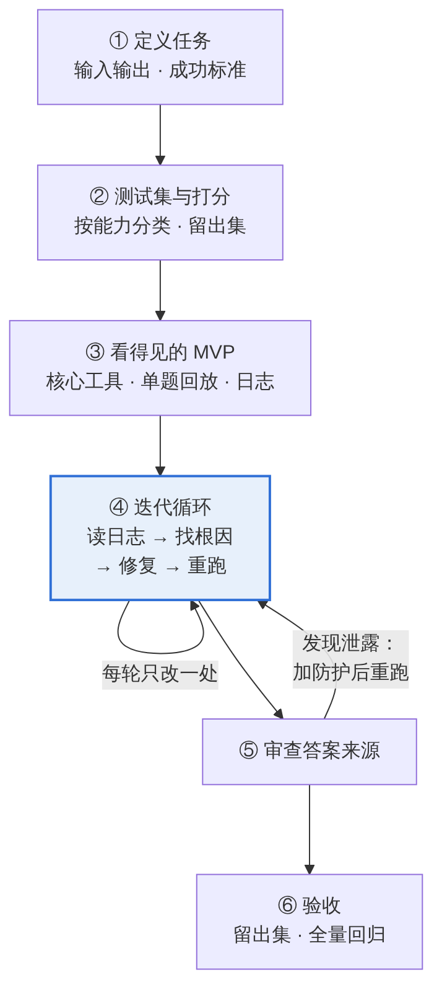

# Agent 从 0 到 1 实战 SOP：以 GAIA Agent 为例

[English](SOP.md) | **中文** · [返回 README](../README.zh-CN.md)

做好一个 agent 靠的不是一次写对，而是一条循环：**运行 → 读日志 → 找根因 → 修复 → 验证**。这份 SOP 把从 0 到 1 拆成六个阶段，案例全部来自这个 GAIA Agent：同样的框架和模型，从 v1 预计只能稳定答对约 3 题，做到官方评分 20/20。

适用于任何"模型 + 工具 + 循环"的任务型 agent，比如研究检索、数据查询、文件处理。

**贯穿始终的六条原则**

1. **先诊断，再动手**。每一处修改都要有日志证据，不凭感觉改。
2. **信息先于智力**。大多数失败是模型拿不到信息，而不是不够聪明。
3. **确定的事交给代码**。转写、计算、格式检查，不让模型去"想"。
4. **prompt 表达意图，代码负责兜底**。关键规则用代码强制执行。
5. **修一类问题，不修一道题**。换一道同类题，修法依然有效才算修对。
6. **分数越高，越要查答案来源**。能上网的 agent 会找到任何现成的答案。

<p align="center"></p>

阶段一到三基本只做一次；阶段四反复循环，直到达标；阶段五发现答案来自泄露源时，加上防护后退回阶段四重跑。

---

## 阶段一：定义任务和成功标准

写代码前先写清三件事：输入是什么，输出什么格式，怎么判定对错。成功标准至少包括：

- **准确率**：能用脚本自动打分。
- **答案有依据**：每个答案都能追溯到原始来源。
- **格式合规**：输出能被程序直接比较，没有多余解释。

后两条在 GAIA 里是踩坑后才补上的：先是 "Unable to determine" 和长篇回答大量丢分，后来又发现部分答案来自泄露源。

动手前先自己手做两三道题。手做时打开了哪些网页、读了哪些文件，就是工具清单的草稿。

## 阶段二：准备测试集和打分

按能力给题目分类，比如检索、附件、视频、纯推理。失败集中在哪一类，就知道缺的是哪种能力。

从题目中留出约 5 道，调试时不看、不跑，最后才用来验收。

打分脚本先于 agent 写好，每次改动后立刻能看到分数变化。

## 阶段三：搭一个看得见的 MVP

**选框架**看三点：循环是否透明，能否接自己的模型，有没有扩展点，比如追加 prompt、校验答案、设置超时。这里选 smolagents `CodeAgent`：模型每步写 Python，一步内能调多个工具、直接计算。

**工具先给两三个**：搜索、读网页、读文件。其余的等日志证明需要再加。

**prompt 只做加法，不能和框架冲突**。v1 的 prompt 是这样写的：

```
Rules:
- Use tools when necessary.
- Verify information.
- Return only final answer.

Never output:
- python code
- tool calls
- logs
- reasoning trace
```

而 CodeAgent 恰恰靠代码块行动，结果第一步就报错：

```
Error in code parsing:
Your code snippet is invalid, because the regex pattern <code>(.*?)</code> was not found in it.
```

**可观测性先于功能**。最先要搭的是这四样：

| 能力 | 作用 |
|---|---|
| 单题运行 | 改一处只跑相关的题，几十秒拿到反馈 |
| 每题完整日志 | 记录每一步的思考、代码和工具返回 |
| 答案缓存 | 答对的题不用重跑 |
| 本地打分 | 改完立刻看到分数 |

没有这些时，每改一处都要把 20 题全跑一遍，还看不到 agent 在哪一步出错。

## 阶段四：迭代循环

一轮的流程：跑单题 → 读日志 → 找根因 → 选层修复 → 重跑验证。项目大部分时间花在这里。

### 读日志：按顺序问五个问题

| 顺序 | 问题 | 日志里的信号 |
|---|---|---|
| 1 | 信息拿到了吗 | 换了关键词，工具返回的内容还是一样 |
| 2 | 行动合法吗 | `Error in code parsing` |
| 3 | 执行成功了吗 | `InterpreterError`、`exceeded the maximum execution time` |
| 4 | 推理对吗 | 信息齐全，结论却错 |
| 5 | 停得对吗 | `Reached max steps.`、非答案、反复验证 |

越靠前越基础。信息没拿到时，讨论推理没有意义。

### 修在哪一层

| 根因 | 优先修在 |
|---|---|
| 拿不到信息 | 工具 |
| 框架行为：超时、截断、格式 | 运行时配置或模型适配层 |
| 指令冲突或缺失 | prompt |
| 输出不合格 | 代码校验：驳回非答案、规范格式 |

能在工具和代码层解决的，不靠改 prompt。

### 真实日志里的六个问题

#### 1. 工具只给摘要，agent 原地打转

一道 Wikipedia 统计题，v1 前后换了十几次关键词，拿到的都是同一段：

```
wikipedia_search(query="Mercedes Sosa discography studio albums")
Title: Mercedes Sosa
Summary: Haydée Marta Mercedes Sosa Girón was an Argentine singer ...

wikipedia_search(query="Mercedes Sosa albums discography")
Title: Mercedes Sosa
Summary: Haydée Marta Mercedes Sosa Girón was an Argentine singer ...
...
Reached max steps.
```

- **根因**：工具调用的是摘要接口，只取第一条结果，正文里的专辑表格根本拿不到。
- **修法**：改为返回解析后的全文和表格，支持读取指定日期的历史版本；新增读任意网页的工具。
- **可迁移**：agent 反复换关键词，先怀疑工具，而不是模型。

#### 2. 环境坏了，看起来却像"没搜到"

```
web_search(query="Mercedes Sosa discography studio albums list wikipedia")
ERROR: No module named 'duckduckgo_search'

for attempt in range(3): web_search(...)
Result: ERROR: No module named 'duckduckgo_search'
```

- **根因**：搜索依赖没装，包也已改名为 `ddgs`。agent 看不出这是环境问题，还在重试。
- **修法**：换成 `ddgs`，加上重试和超时。
- **可迁移**：上线前把每个工具单独跑一遍；报错要说清是环境坏了还是确实没结果。

#### 3. 框架沙箱拦住了正常代码

```
Code execution failed at line 'import subprocess' due to: InterpreterError: Import of subprocess is not allowed.
Code execution failed at line 'print("WIKI:", repr(b))' due to: InterpreterError: Forbidden function evaluation: 'repr' is not among the explicitly allowed tools
```

- **根因**：CodeAgent 的本地执行器有 import 白名单和函数白名单，模型写的是普通 Python。
- **修法**：放开常用的库和 `repr`；下载视频、跑子进程这类重操作封装成工具。
- **可迁移**：用一个框架，先读它的沙箱规则和默认值。

#### 4. 工具参数不容错

模型把完整链接传给只接受视频 ID 的工具，工具又拼了一次前缀：

```
Could not retrieve a transcript for the video
https://www.youtube.com/watch?v=https://www.youtube.com/watch?v=L1vXCYZAYYM!
You provided an invalid video id.
```

- **修法**：工具同时接受链接和 ID，内部统一解析。
- **可迁移**：按模型最可能的调用方式设计参数，容错交给工具。

#### 5. 跑到上限，答案被吞掉

```
Reached max steps.
[GAIA] timeout
Answer: TIMEOUT
```

另一题跑了 746 秒，算出的答案同样被换成 TIMEOUT。音频、视频工具则在 smolagents 默认的 30 秒处被杀掉：

```
Code execution exceeded the maximum execution time of 30 seconds
```

- **根因**：外层跑完才检查总耗时，直接丢弃答案；执行超时用的是框架默认值。
- **修法**：删掉事后超时检查；执行超时放宽到 900 秒；步数用完时从已收集的证据里提取答案。
- **可迁移**：停止条件要有兜底，任何退出路径都尽量交出答案。

#### 6. 交出的不是答案

v1 的 prompt 要求"明确表达不确定"，5 道题直接提交了 "Unable to determine"。另一种情况是拿到可靠结果后还在反复验证，直到步数用完。DeepSeek 偶尔还会输出自己的 DSML 工具调用标记，触发同样的 `Error in code parsing`。

- **修法**：`answer_check` 驳回非答案和长篇解释，`clean_answer` 统一格式；工具输出直接标明结果可靠、无需再验证；模型适配层把 DSML 改写成代码块。
- **可迁移**：关键规则不能只写在 prompt 里，要有代码校验兜底。

### 修复的三条纪律

- **先做最小复现**：单独调用出问题的工具，确认根因再改。
- **给 AI 精确指令**：写明改哪个文件、哪个函数、不动什么。例如"只改 tools.py 的 `wikipedia_page`，改用 parse 接口返回全文，不要动其他工具"。
- **每轮只改一处**：改完立即重跑同一题，再回归已答对的题。

## 阶段五：审查答案来源

分数上来后，对每道答对的题，在日志里找答案**最早**出现在哪一步、来自哪个网址。日志里出现过 agent 自己去搜答案：

```
web_search(query="<task_id> GAIA answer")
```

泄露源有四类：benchmark 转载、他人公开的运行记录、按搜索词生成的 SEO 页、agent 主动搜答案。对应三层防护：

| 层 | 做法 |
|---|---|
| 查询 | 拒绝针对 benchmark、task ID、答案表的搜索 |
| 结果 | 过滤转载、运行记录、与题目文字高度重合的页面 |
| 策略 | prompt 明确禁止查找 benchmark |

受影响的 4 题开启防护后重跑，答案都从原始资料得出。能上网的 agent 会直接优化"答对"本身，所以溯源要和打分一样，每轮都做。

## 阶段六：验收

- 用留出集验收，看 agent 在陌生题上的真实表现。
- 全量回归，确认最近的改动没有改坏已答对的题。
- 不稳定的题多跑几次。结果来回摇摆，说明还有一步在靠运气。

## 实战心得

1. **框架会静默失败**。沙箱白名单、30 秒超时、输出截断、格式漂移都不显眼，只会默默吃掉步数。先读框架的默认值。
2. **工具是给模型用的接口**。输入要容错，返回模型读得懂的文本，报错要说明下一步该怎么做。
3. **迭代速度会复利**。单题回放加每题日志，把一轮反馈从几十分钟缩短到几十秒。
4. **借助 AI 写代码时，你负责诊断和验收**。AI 改得很快，但改哪里、改得对不对，要靠日志和测试来判断。
